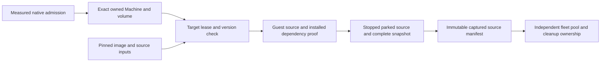

# Independently owned immutable fleet sources

`scripts/run-bench-fleet` normally uses the shared `cloudbench-warm` source. Its
stopped-source guard remains mandatory. If another owner is using that source,
an independently prepared source can be selected without changing shared state:

```bash
CLOUDBENCH_SOURCE_MANIFEST=/absolute/path/source-manifest.json \
  bash scripts/run-bench-fleet <bench> [<bench>...] [existing flags]
```

Preparation and retirement belong to the source's owner, outside fleet teardown.
The fleet never creates, refreshes, starts, parks, updates, or deletes this base.
It only validates it and clones its completed snapshot. Do not prepare a source
by stopping or modifying another owner's machine. Retain the source until every
fleet that references it has completed exact resource cleanup.

The version-one manifest has exactly these fields:

```json
{
  "version": 1,
  "app": "navi-whisper-lux-bench",
  "owner_token": "<32 lowercase hexadecimal characters>",
  "machine_id": "<exact machine ID>",
  "instance_id": "<native instance ID after final configuration>",
  "machine_name": "cloudbench-source-<full owner token>",
  "volume_id": "<exact vol_ ID>",
  "region": "iad",
  "image_digest": "sha256:<64 lowercase hexadecimal characters>",
  "snapshot_id": "<exact vs_ ID>",
  "node_fingerprint": "<current Node manifest fingerprint>",
  "python_fingerprint": "<current Python manifest fingerprint>",
  "verified_at": 1789116920,
  "shared_machine_id": "<protected shared warm machine ID>",
  "shared_volume_id": "<protected shared warm volume ID>"
}
```

The placeholders are documentation, not valid identities. `verified_at` is the
actual Unix epoch of dependency verification. Obtain fingerprints using the
existing helpers in `scripts/lib/cloudbench-env.sh`; verify the installed Node
and Python fingerprint markers inside the owned source before taking its snapshot.
The existing task-guest installed-dependency check still runs on every clone.

The source must be stopped and already parked at shared CPU, one CPU, and the
configured parked memory (default 2048 MiB). Its only mount is the named volume at
`/data`. The volume must be created, attached to that exact machine, and in the
same region. The provider's native instance, pinned image digest, machine name,
and `config.metadata.cloudbench_source_owner` must match the manifest. The
snapshot must be complete, belong to that exact mounted volume's snapshot list,
and pass the existing snapshot selector's completeness rule. It cannot predate
dependency verification beyond the existing 60-second timestamp allowance.

The fleet captures one immutable canonical copy before allocation. The same
captured bytes determine the selected identities, pool namespace, registry/audit
proof, and execution provenance. A changed caller file cannot retarget a running
fleet. Native instance, stopped state, and storage readiness are checked again
at clone admission through the existing refreshed inventory index.

Private mode rejects stale dependency fingerprints and never invokes shared
dependency maintenance. It rejects either protected machine or volume in pool
claims and cleanup mutations. Default shared mode remains unchanged. Exact stale
owner recovery restores the private/shared protections from matching, digest-bound
registry and audit copies even when the original environment variable is absent.
A missing or changed required manifest fails closed and retains ownership.

See the [source-selection RCA](rca/cases/2026-09-12-fleet-required-active-shared-source-without-owned-alternative.md)
for the causal offline proof and remaining live validation gate.

## Native preparation isolation

Preparation is a separate owner transaction: measured native admission establishes
a private source, then a target Machine lease and version check fence image,
checkout and dependency preparation. Unrelated fleet lifecycle changes never
provide mutation authority and never invalidate a correctly owned transaction.



Preparation must never stage app-global secrets. It verifies the target guest
environment against its frozen contract before publishing a usable snapshot.
Every provider mutation belongs to the exact owned resource journal; an unknown
owner, expired lease, ambiguous native write or changed source refuses publication.
Failed historical preparations retain their original outcomes and grant no new
cleanup or financial credit.

New native preparations publish **version two**, adding `lease_protocol` equal to
`cloudbench-source-lease-v1` and the exact `creation_nonce` from the original
creation journal. It also requires `guest_env_sha256`, the two observed raw-base64
environment digests sealed by preparation. Each primary and autoscaled worker
receives the captured manifest through its trusted boot payload or wrapper and
checks effective secret values against that contract before decoding files or
starting a stack. A coherent rotation of an app blob and its companion digest
therefore refuses this source rather than silently changing its environment. Legacy readers reject this schema. Current readers refuse a
version-one downgrade of a native protocol-tagged source. Existing version-one
sources retain their original behavior.

A short native Machine lease protects reader claim publication, claim closure
and retirement. It is released **before reader readiness**, so independent
fleets can clone the same immutable snapshot concurrently. Durable, individually
owned consumer claims persist for each fleet's lifetime. Their guardian's local
heartbeat is admission health, not a claim that a native lease remains held.
A dead or expired guardian fences new admission and retains its claim. Retirement
refuses any open claim and holds its native lease through guarded deletion.

The normal fleet reader captures the manifest, binds its original registry and
source audit, publishes its claim, and checks guardian identity/source binding
before clone or pool admission. It closes only after its canonical audit,
registry retirement and lifecycle prove exact resource cleanup. Normal
`--reconcile-cleanup` also closes a recovered version-two claim through its
original native custody, including when the registry was already retired.
Recovery appends physical-closure evidence and never rewrites a failed lifecycle
or grants historical task credit.

The Linux preparation CLI requires existing Fly/GitHub credentials. It creates
at most one source per immutable operation journal, measuring organization quota,
all app inventories and pending local reservations before allocation. An
ambiguous create retains its journal and never authorizes another create.

```bash
python3 scripts/cloudbench-prepare-source-create.py create \
  --journal "$CREATE_JOURNAL" --owner-token "$SOURCE_OWNER" \
  --donor-machine-id "$DONOR_ID" --donor-volume-id "$DONOR_VOLUME" \
  --snapshot-id "$COMPLETE_ATTESTED_SNAPSHOT" --org personal \
  --reserved-slots 0 --headroom 1
python3 scripts/cloudbench-prepare-source.py request \
  --ownership "$CREATE_JOURNAL/result.json" --build "$IMAGE_BUILD_RECEIPT" \
  --source-root "$PWD" --source-ref "$FROZEN_SOURCE" \
  --guest-env-contract "$ENV_CONTRACT" --protected-resources "$PROTECTED_RESOURCES" \
  --output "$PREPARE_REQUEST"
python3 scripts/cloudbench-prepare-source.py \
  --request "$PREPARE_REQUEST" --output "$PREPARE_OUTPUT"
CLOUDBENCH_SOURCE_MANIFEST="$PREPARE_OUTPUT/source-manifest.json" \
  bash scripts/run-bench chat-mode --runs 1 --concurrency 1
```

Each path is an absolute operation-owned path. `SOURCE_OWNER` is a fresh
32-character lowercase hexadecimal token, never a claim over an existing
foreign Machine. `ENV_CONTRACT` contains exactly `AGENTS_ENV_B64` and
`BACKEND_ENV_B64`, each the SHA256 of the expected effective base64 string.
Derive these expectations from the authorized guest environment projection,
including its benchmark Temporal namespace. These are observations to verify,
not an instruction to stage app secrets. A mismatch refuses preparation.
`PROTECTED_RESOURCES` contains the exact protected Machine-to-volume mappings.
`--reserved-slots` accounts only for additional known prospective reservations;
it never subtracts native reserved objects or grants capacity credit.

An unpublished source can use the existing sealed base-plus-patch transport via
`request --transport`. The producer reconstructs the exact Git tree and checks
image-input equivalence before effects; the guest reconstructs that same tree
before dependency synchronization and attestation. The source may adopt a new
dependency set only from an exactly matching immutable image, using the existing
dependency synchronizer with online rebuilding disabled. Preparation uses the
existing four-CPU/8192-MiB maintenance shape and parks at one CPU/2048 MiB.

Retirement uses `cloudbench-prepare-source-create.py cleanup` with the same bound
creation flags plus `--prepared-request`, `--prepared-result` and
`--prepared-manifest`. It takes the native writer lease and refuses active or
unknown claims. Preserve all journals and source manifests through consumer
cleanup. A failed or ambiguous preparation never supplies a successful successor
or guessed cleanup authority.

## Isolated guest environment

An explicit `owned-capsule-v1` preparation can carry the authorized environment
on its own encrypted volume. The capsule builder verifies private, hash-pinned
approved files, the canonical worker browser-provider projection, the existing
benchmark Temporal projection and the coordinator's authenticated production
provider capture. It preserves the approved backend bytes. Capsule contents
never enter Git, Machine configuration, command arguments or ordinary journals.

Use `cloudbench-source-env.py build --request PRIVATE_JSON --request-sha256 HEX
--output PRIVATE_FILE`, then pass that private file to the preparation request
builder with `--guest-env-capsule`. The request's two raw-base64 digests must
match the capsule. Preparation transfers the file through bounded private SFTP
under its native lease, verifies the exclusive staging inode and bytes, and
publishes an immutable hash-named file under `/data/.cloudbench-private/env`.
The directory is root-owned mode 0700 and the file is mode 0600.

Owned manifests add exactly `guest_env_mode`, `guest_env_capsule_sha256` and
`guest_env_capsule_binding`. The binding seals owner, creation nonce, preparation
source, image and both dependency fingerprints. The captured manifest hash is
bound to execution provenance. Its preparation source can differ from the
consumer's fetchable base when the existing base-plus-patch transport proves
the actual consumer tree.

Owned-capsule consumers explicitly use the qualified private source snapshot
for primary and new worker volumes, so the private file exists before boot.
An incompatible explicit fresh-only or cold-bootstrap request refuses before
allocation. Ordinary ambient consumers retain their existing fresh-volume
behavior. Every owned runner replaces its original shell through the capsule
loader before decoding environment files or starting work; reentry checks the
effective values again. Missing files, changed bindings or cleared markers
cannot fall back to ambient app secrets.

If a completed guest and parked resource have an accepted snapshot
acknowledgement but the original operation failed before publication,
`cloudbench-prepare-source.py finalize-snapshot --request ORIGINAL_REQUEST
--failed-result ORIGINAL_RESULT --output NEW_DIRECTORY` can verify that exact
transaction under a new native lease. It performs only resource/readiness GETs
and lease operations. It cannot start a guest, create another snapshot or adopt
a caller-supplied snapshot ID. It publishes a distinct finalized authority only
after strict completion and release checks. The old failed result remains false
and grants no historical task credit.
