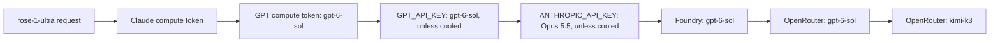

# Microsoft Foundry fallback

## Current route

Only `rose-1-ultra` uses Foundry. Its GPT compute-token model is `gpt-6-sol`,
so the Foundry deployment must also serve GPT-6 Sol. GPT-6 Astra does not
need a deployment for the current pool configuration. The `rose-1-mini`, flash,
browser-use and open-weights pools keep their existing routes.



Each arrow means the previous route was unavailable or failed before any
caller-visible output. A stream that fails after content starts is surfaced as
an error; mixing output from two deployments would corrupt tool calls.
Each new request starts at the top and stops after the first successful route.
Compute credentials rotate or cool on provider failures. Both shared API keys
use separate DB-backed 30-minute cooldowns across users, backend instances,
and agents after credit exhaustion or authentication failure. For GPT_API_KEY,
`429 insufficient_quota`, credit exhaustion, spend-limit codes, and 402 count
as exhausted credits, including when OpenAI reports the error inside an HTTP
200 Responses stream. An ordinary 429 remains a short rate limit. Agents
refresh the shared key status through the
backend, with a 15-second local cache, before deciding whether to skip a key.

The Foundry route reuses the GPT compute-token Responses body and parser:
reasoning effort, instructions, tool choice, structured output, stateless
reasoning items, prompt cache key, and the caller's Fast Mode choice. Fast
Mode sends `service_tier=priority`, as it does for GPT compute tokens;
Microsoft supports request-level priority for GPT-6 Sol Global Standard.
The deployment name substitutes for the GPT model ID in the request body.
The exact outbound JSON body is compared against the GPT compute builder in
both code paths. The live contract tests also confirm Azure accepts xhigh
reasoning, forced tool calls, strict JSON schema, streaming, and Priority.
A direct nonstreaming call on 2026-10-01 returned HTTP 200 with
`model=gpt-6-sol`, `service_tier=priority`, and completed usage, confirming
that Priority actually served that sampled request. Azure can still downgrade
individual Priority requests when capacity or ramp limits apply.
`temperature` and `max_tokens` are omitted by the GPT compute builder for
this model, so Foundry omits them too; an accepted `store=false` or cache key
does not itself prove server-side retention or cache hit behavior.

## Configure and verify

1. Resource `a-4989-resource` in `rg-roselabs-ai-prod` already serves the
   `gpt-6-sol` deployment: authenticated Responses calls passed on 2026-09-28
   and 2026-09-29.
   The inference endpoint is `https://a-4989-resource.openai.azure.com`,
   while the Foundry project URL under `/api/projects/a-4989` is for project
   management. The project-scoped deployments list is empty, but the resource
   accepts `gpt-6-sol` and rejects an unknown name with `DeploymentNotFound`.
   A live response returned `x-ratelimit-limit-requests: 10000` and
   `x-ratelimit-limit-tokens: 10000000`. Treat those as observed limits, not a
   quota guarantee; the deployed SKU, allocation, and subscription tier still
   need a management-plane check. For another deployment, first verify the
   model version and available Global Standard capacity in Foundry, then assign
   a distinct name and allocate part of the existing quota. The successful
   data-plane call does not reveal the deployment's configured model version
   or capacity.

2. Set the following in both `agents/.env` and `back-end/.env` locally and in
   the corresponding Fly and Render secret stores for production. Keep the
   key out of source control and chat.

   ```dotenv
   AZURE_FOUNDRY_ENDPOINT=https://a-4989-resource.openai.azure.com
   AZURE_FOUNDRY_API_KEY=<resource API key>
   AZURE_FOUNDRY_DEPLOYMENTS=gpt-6-sol
   ```

   The endpoint may also end in `/openai/v1`; the clients normalize it. If
   either endpoint or key is absent, this route is disabled. The deployment
   list defaults to `gpt-6-sol` when omitted.

3. Run `RUN_FOUNDRY_LIVE=1 PYTHONPATH=agents python3 -m pytest -q
   agents/tests/e2e/test_foundry_live.py` and, from `back-end/`,
   `RUN_FOUNDRY_LIVE=1 npx tsx src/tests/unit/rose-foundry-live.test.ts`.
   These verify text, forced function calling, strict JSON, and a full Rose
   Ultra route through the actual deployment. Both passed again on 2026-10-01 with
   `actual_model=gpt-6-sol-foundry`. They read local `.env` files without
   printing credentials.

The two code paths use `api-key` authentication. Microsoft also supports
Microsoft Entra ID; adopting it would require an identity and inference role
on every host, followed by a separate transport change.

## Cost and quota

Global Standard base-model deployments use pay-per-token pricing, with no PTU
reservation. For GPT-6 Sol, Microsoft's current published Global Standard
prices are, per million tokens: **$2 input, $0.20 cached input, $2.50 cache
write, $10 output** for short context; **$4, $0.40, $5, $15** respectively
for long context. Azure bills the resource even though Rose marks the
`-foundry` route as **$0 in user-facing token cost**, matching the requested
compute-token treatment. This zeroing is an accounting policy, not free Azure
inference. Rose's per-agent price limit uses that same user-facing cost ledger,
so Foundry does not advance the user's limit, just as compute-token calls do.
Track the separate Azure expense through Cost Management and resource budget
alerts. Azure budgets send alerts rather than stopping inference, and quota is
a throughput limit rather than a spend cap. Foundry quota tiers can increase
automatically with usage; use an application spend guard if a hard cap is
required.

Priority requests can have a higher token rate; Microsoft's public
pricing page has not yet published GPT-6 Sol's Priority Processing rate, so
confirm it in the Azure pricing portal or billing agreement before enabling
production traffic. Monitor Azure Cost Management for actual spend. Provisioned
throughput would add an hourly PTU bill even while idle; it is not configured
here. See [Microsoft's GPT-6 pricing](https://azure.microsoft.com/en-us/blog/gpt-6-astra-sol-and-luna-for-production-agents-in-microsoft-foundry/)
and [priority processing](https://learn.microsoft.com/en-us/azure/foundry/openai/concepts/priority-processing).

Foundry sets deployment TPM and RPM limits from assigned quota. Azure can
return 429s for short bursts even before a minute's nominal quota is used.
The clients honor `retry-after-ms` or `Retry-After` as a local cooldown
(capped at 60 seconds), try any other configured deployment, then promptly
spill to OpenRouter. They do not replay a partial stream. There is no global
cross-process limiter yet; tune the deployment from real `x-ratelimit-*`
headers and request a quota increase if Foundry becomes a frequent fallback.
See [Microsoft's rate-limit guide](https://learn.microsoft.com/en-us/azure/foundry/openai/how-to/quota).

**A second Global Standard deployment does not multiply the available
GPT-6 Sol quota.** Microsoft's newer subscription-level quota scheme shares
one model/version pool across Global Standard deployments and regions; older
quota guidance describes per-region allocations during this transition.
Check this subscription's actual tier and allocation before assuming its scope.
Multiple deployments can partition assigned TPM,
reduce a deployment-level burst hotspot, or provide a separate operational
target. Set `AZURE_FOUNDRY_DEPLOYMENTS=gpt-6-sol,gpt-6-sol-b` only after the
second deployment has capacity. The agent stack hashes the agent ID (or user
ID when available) to choose a starting deployment. The backend uses an
explicit route key or dump agent ID when supplied, then a compute-grant user
ID, otherwise a request ID; ordinary synchronous chat uses the request ID.
On pre-content 429,
it walks the other names. All users and agents still share the Azure quota;
this is traffic distribution, not a quota increase. See [Microsoft's current
quota scope](https://learn.microsoft.com/en-us/azure/foundry/openai/quotas-limits)
and [quota management guide](https://learn.microsoft.com/en-us/azure/foundry/openai/how-to/quota).

## Multiple regions

A single deployment's TPM ceiling is a hard per-deployment limit: Azure reports
it as a 429 or, mid-request, as an in-stream `rate_limit_exceeded` error. Both
clients therefore accept further Azure resources, normally in other regions.
The unsuffixed variables stay region 1; numbered sets add regions 2 to 9:

```dotenv
AZURE_FOUNDRY_ENDPOINT_2=https://<resource>.openai.azure.com
AZURE_FOUNDRY_API_KEY_2=<that resource's key>
AZURE_FOUNDRY_DEPLOYMENTS_2=gpt-6-sol
```

A region needs both endpoint and key; every configured endpoint must be HTTPS
or the Foundry route rejects the request before sending anything. Region 1 still
falls back to the model ID when its list names no matching deployment; regions
2 to 9 serve only the deployments they list, so a resource with only GPT-6 Sol
never receives Luna or DeepSeek traffic.

Routing per request:

- The route key (agent ID, then user ID, then request ID) ranks regions by
  rendezvous hashing. One agent keeps the same primary region while healthy,
  preserving its prompt cache; agents spread evenly over regions; adding a
  region moves only the agents it takes over. Inside a region, deployments keep
  the existing per-key rotation.
- Before any visible output, a 429 or in-stream rate limit cools that exact
  region and deployment for `retry-after-ms`/`Retry-After` (1 to 60 seconds) and
  the next region is tried at once. 5xx and transport errors also try the next
  region, without a cooldown. Each failing region's traffic spreads over all
  other regions in that key's own order.
- A 401/403 cools only that region's key for five minutes; the other regions
  keep serving. A 400 or in-stream invalid request stops the Foundry route,
  because every region would reject the same body.
- Output already sent is never followed by another region's output.
- When every region and deployment is cooling, the route raises
  `RoseRateLimitError` without a request, and the waterfall continues.

`rose.foundry.attempt_failed`, `stream_failed`, `transport_failed` and `served`
(agents) and `foundry.*` (backend) log `region` (endpoint host), `region_slot`
and `deployment`, never a key. Cooldowns are per process, sized by the number
of configured deployments; a request makes at most one attempt per
(region, deployment) and none while all are cooling. Additional regions add
deployment-level throughput only within the subscription's model quota.
The live contract tests above probe every configured region separately.

## Verification status

The mocked Responses and 429/stream tests and both live contract tests pass.
Local `agents/.env` and `back-end/.env` contain the endpoint, key, and deployment
name. Render's stored values were read back and matched, its deploy completed,
and `/health` returned 200. Fly lists all three secrets as Deployed, and every
started worker checked had the matching runtime values. The fallback was merged
and deployed to both Render and Fly on 2026-10-01. The production semantic gate
passed after rollout. These checks do not measure sustained throughput.
