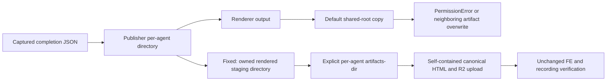

## Problem

The canonical evidence publisher failed after Hub upload and native mirror for
the completed phone attempt. Parent's source run remains FAIL due to the
separately owned final-output reader; evidence publication must preserve that
verdict. Parent had already resolved its missing env and provisioned the owned
0700 rca_evidence directory. Those setup issues were not this failure.

Captured exact child command (agents/venv Python): scripts/render_llm_dump.py
.llm-dumps/4251eeca-4024-46ea-9196-e81a1b2eaad3/1792355642409-90d9c12171b7-completion_summary.json
-o /opt/cursor/artifacts/rca_evidence/4251eeca-4024-46ea-9196-e81a1b2eaad3/last_llm_call.html --no-open.
Direct execution exited 1 with PermissionError in publish_rendered_dump,
shutil.copy2 to /opt/cursor/artifacts/last_llm_call.html. Root is root-owned
0755, while the scoped rca_evidence directory is boxes-owned 0700. No protected
permissions were changed. Input contents or env secrets were not printed.
Safe stderr capture: .context/phone-harness/renderer-current-red.stderr.

## Diagnosis

Archive searches: `render_llm_dump special token tiktoken`, `evidence publisher
child renderer CalledProcessError`, then evidence-specific `artifacts
PermissionError renderer copy2`. Searches found renderer and evidence relatives,
not the shared-root destination mismatch. This is a novel ownership-boundary
failure; no prior classification/filtering fix was adopted.

Hypothesis fields, confirmed by owning regression:
- What: valid rendered evidence fails before HTTPS publication/FE verification.
- Where: publish_llm_dump specifies -o but not --artifacts-dir.
- Why: renderer writes -o, then copies a self-contained version into its default
  shared root. The writable per-agent output does not scope this second write.
- Proof: exact captured child exits PermissionError; the permanent test's real
  renderer overwrites an unrelated shared-root sentinel before the fix and
  leaves it intact afterward.
- Problem: a composed artifact producer passed one output destination while
  silently inheriting another destination with broader custody requirements.

Binary search: Hub/native mirror succeeded; initial HTML render succeeded;
copy to default shared root was the first bad boundary. The renderer already
supports explicit artifact custody, so no renderer fallback, permission change,
or verification bypass is needed. Primary technical source is local renderer
publish_rendered_dump and its --artifacts-dir contract; the publisher now
converges on that existing interface. No external/provider behavior is blamed.

## Solution

Only publisher production code changes: render under
<agent-dir>/rendered/last_llm_call.html, pass --artifacts-dir <agent-dir>, and
retain <agent-dir>/last_llm_call.html as the self-contained canonical output.
This avoids same-directory sidecar copy/deletion and shared-root writes.
No renderer source change was needed.

Owning regression added to existing publish_evidence_links_composite.test.sh:
real renderer, synthetic completion summary, isolated owned and shared roots,
unchanged shared sentinel, canonical output existence/self-containment. Only
R2 env is cleared for this offline causal test; real publication separately
proves R2/FE. Exact command `bash scripts/tests/publish_evidence_links_composite.test.sh`:
red exit 1 `renderer wrote into shared artifacts root`; unchanged green exit 0.
Logs: .context/phone-harness/publisher-owning-red.log and publisher-owning-green.log.

The existing durable gate's fake renderer initially failed FileNotFoundError
because it assumed -o's parent already existed. Correct its positive producer
setup to create render parents and the explicit published artifact; add an
assertion that the canonical HTML exists. Do not weaken existing URL assertions.
Normal `bash scripts/tests/durable-evidence-links.test.sh` now exits 0; this
gate invokes the composite regression and is registered in deploy structural
gates. Browser-validation script exits 0. Normal agents blackbox command
`cd agents && source venv/bin/activate && python scripts/run_blackbox_tests.py render_llm_dump`
passes. bash syntax, Python AST parsing, and git diff checks pass.

Actual same canonical command after fix, agents/venv active:
`python -u .context/phone-harness/publish-live-evidence.py --run-json agents/benchmarks/runs/20261018_203421_6a6d0399-1e5a-45eb-bab0-f3c463e27faa_browser-cloud-iphone-settings.json --agent-id 4251eeca-4024-46ea-9196-e81a1b2eaad3`.
Exit 0; fresh-browser FE verified with 50 messages, browser termination/recording
validation retained, real R2 upload completed, separate HTTPS GET returned 200.
Manifest: /opt/cursor/artifacts/rca_evidence/4251eeca-4024-46ea-9196-e81a1b2eaad3/manifest.json.
Log: .context/phone-harness/evidence-publication-fixed.log.
Readback/verdict proof: .context/phone-harness/evidence-publication-proof.json.
Exact signed links are in the manifest/log, not duplicated in the tracked case.
Source task passed=false and original failed summary remain intact.

10k behavior: one extra path component and explicit argument per publication;
no shared-root basename collisions, new background work, provider calls, scans,
or fleet fan-in. Existing uploads/verification counts and semantics unchanged.

RCA remains OPEN solely for parent-owned unchanged canonical phone benchmark
rerun/outcome proof; this work proves evidence publication, not benchmark PASS.
Parent reviews/commits/reindexes. Normal archive validation may report stale
INDEX until that parent action; no shared index was edited here.

## Unchanged canonical outcome verification — 2026-10-18

The prior OPEN handoff statements above describe the evidence available then;
the unchanged native outcome gate is now closed. Parent ran the normal command
`bash scripts/run-bench --local browser-cloud-iphone-settings --run-id phone-connectivity-20261018t2042-r2 --no-dashboard`
at checkpoint `379cd490cf75ec87fa4cfbbc179f0222c429ee8d`. Its native controller
exited 0. Native run
`agents/benchmarks/runs/20261018_204540_75a7f70a-71c5-4929-87d9-6e772ae450d7_browser-cloud-iphone-settings.json`
records **PASSED**, COMPLETED, score 1, 177.3 seconds, 51 messages, and no failure.
The FINISHED canonical completion card reports typed `visible_heading` =
`Paired Computers`; the strict persisted launch/OCR/heading and no-attention
checks passed. This is actual Rose/cloud-phone evidence, not a replay verdict.

Original trigger: `2026-10-18T20:06:57.416731+00:00`; third-attempt trigger:
`2026-10-18T20:41:34.224899+00:00`. Hub:
`75a7f70a-71c5-4929-87d9-6e772ae450d7`; root:
`b53db629-4b68-4d7a-b763-1777d3b15f45`. The original ERROR and second FAIL
remain failures; the third PASS does not rewrite either. The original
controller's finalizer lost its native completed run/ledger row. A source-tagged
ERROR row was appended to `history/task_attempts.jsonl`, preserving every prior
byte. Its 457-second duration is explicitly the rounded original report display,
not an invented exact tenth; timestamp comes from the original local Hub run.
No token counts were inferred. Backfill provenance:
`.context/phone-harness/goal4-close-history-backfill.json`.

`tasks.py` does not exist in this benchmark package; the authoritative
`agents/benchmarks/tasks.json` is byte-identical from `33bf65449502dd377dec57f576f8590bdb091d71`
through `379cd490cf75ec87fa4cfbbc179f0222c429ee8d`, SHA256
`711a7f0f0e05db71042792751fbb7e1ad3c347285a943d0789a7cf93059363b8`.
All six recorded runtime hashes in
`.context/phone-harness/live-connectivity-retry2-slice.json` match both the pass
checkpoint and closure-time checkout. Verification receipt:
`.context/phone-harness/goal4-close-frozen-proof.json`. These are bug fixes under
unchanged task criteria, not a claim that all runtime files match the buggy revision.

Parent's retry log records cleanup `started=2 completed=2 state=clean`.
Both task and local-stack receipts are clean, and local-benchmark-owner state is
`cleanup_verified`. No resource stop acknowledgment substitutes for this proof.
The real canonical publisher completed; fresh-browser FE verification saw all
51 messages and retained browser termination/recording checks. The rendered dump
was published to HTTPS and its recorded readback returned 200. Exact verified
share/HTTPS links and canonical HTML are retained in
`/opt/cursor/artifacts/rca_evidence/b53db629-4b68-4d7a-b763-1777d3b15f45/manifest.json`;
publication log: `.context/phone-harness/live-pass-publication.log`.
Independent closure readback also returned HTTP 200 for the 39,048-byte HTML;
`.context/phone-harness/goal4-close-outcome-proof.json` records its hash, native
PASS/FAIL hashes and three preserved attempt rows without copying signed URLs.
The second attempt's separately published FAIL remains unchanged.

This closure ran no additional paid benchmark, live phone operation, deploy,
commit or process intervention. Goal 5 frontend work is independent of this
Goal 4 proof; it is not included in this result.

Closure reran `bash scripts/tests/durable-evidence-links.test.sh`,
`bash scripts/tests/publish_evidence_links_composite.test.sh` and
`bash scripts/tests/publish_evidence_links_browser_validation.test.sh`: all exit 0.
Normal `cd agents && source venv/bin/activate && python scripts/run_blackbox_tests.py render_llm_dump`
also passed all 15 renderer checks. Logs:
`.context/phone-harness/goal4-close-durable-evidence.log`,
`goal4-close-publisher-composite.log`, `goal4-close-publisher-browser.log`, and
`goal4-close-renderer-normal.log` in that directory. Publisher AST parsing and
all three shell syntax checks passed. The existing two dirty regressions and
production publisher diff were retained without weakening assertions; the real
second FAIL and third PASS publications both preserve their native verdicts.

## Human feedback

User limited ownership to evidence scripts, owning regressions and one case;
required actual canonical publication without skipping FE/browser/R2 checks,
original FAIL verdict preservation, no runtime/backend/task/criteria edits,
no commits/deploy/spawn/signals, no private phone credentials, and preservation
of Freedom/AGENTS. Parent owns the next canonical phone retry and archive reindex.

## Reusable lesson

Pass every artifact destination explicitly when composing producers so scoped output never inherits a shared-root publication side effect.
