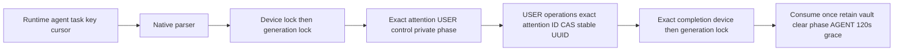

## Problem

Goal6a protects submitted private values, but native auth-assistance context was
ignored by the browser-default parser. Exact native body targetKind=iphone,
browserTaskId, reason, stable requestKey and expectedCursor must not be inferred
from the latest browser session or copied into Steel authentication bookkeeping.
No real passwords, Apple accounts, live provider, iCloud, SMS or production actions
were used. Normal registered auth-assistance blackboxes use actual routes/Prisma,
existing phone provider fake and mock SMS transport; completion signaling/resume
uses the existing dependency seam.

Initial command from back-end:
`bash scripts/run-blackbox-tests.sh auth-assistance`.
Run1792360366-4059929-23590, 23/25 pass, exit1. New tests failed
`Native request lost exact target` (undefined vs task/lease target) and
`Invalid native binding accepted`. Log `.context/phone-harness/goal6b-auth-red.log`.

## Diagnosis

Archive searches: native phone auth assistance binding completion; auth assistance
completion lock user message replay. Related browser provider completion and
phone private-input RCAs informed the path, but did not establish this native
binding boundary. Hypothesis H1: parser drops native fields then service resolves
latest browser session; prediction exact target absent and stale/mismatched native
context accepted. Falsifier: exact target and context checks survive real POST.
Actual normal-route red confirms H1.

Generic response proof: `.context/phone-harness/goal6b-guard-red.log` failed
`Native raw attention response was accepted` through the actual attention/respond
route. Parent owns the generic respond guard. Separate actual reject endpoint
red run1792360618-4104071-17095,26/27 passed, only new reject test failed
`Native rejection persisted a private user message`; parent restored its guard
only after this red. Log `.context/phone-harness/goal6b-reject-red.log`.

A forced native concurrent-completion reproduction then found both callers
signaled resume. Hypothesis H2: a pending-read loser was classified as a later
completed retry after waiting on the device lock. Run1792360739-4126888-2999,
29/30 pass, `Concurrent native completion signaled twice`. Log
`.context/phone-harness/goal6b-concurrent-red.log`. The existing beforeCompletionClaim
seam makes both initial reads pending; it does not fabricate database state.

## Solution

Native parser branches before browser fallback. Stable HMAC-derived request ID
and context HMAC recover the same request; changed reason/task/cursor/key context
conflicts. Metadata root/authAssistance/requestUserAuthentication and serialized
request/handoff carry identical exact kind/task/lease target and critical reason.
Realm constant iphone, forced manual_step, no browser URL or Steel context.

Device-first transaction validates account, agent, task, active lease, cursor and
no physical custody. It creates attention, attaches lease USER control and private
phase atomically; existing in_progress/verifying setup state alone becomes
awaiting_user. Pending auth retains lease and original FIFO queue deadlines.
All USER operations during pending native attention require exact request ID
under device lock, included in HMAC and encrypted intent; PNG observer remains
owner-authenticated and allowed. Generic handback cannot bypass native completion.

Exact completion rejects nonempty userMessage before any authored-message write,
including completed retry. Device lock precedes generation lock; no provider IO
occurs inside transaction. CompletedAt and pending response are consumed once;
phase clears, vault remains, control returns with120s grace, awaiting_user becomes
verifying. No ready/authenticated marker, profile/credential write, Steel auth,
browser health/refresh or onboarding action. Pending-read concurrent loser has
retrySideEffects=false; actual later completed retry is distinguished explicitly.

All work is device-PK/task-PK/request-PK indexed, bounded per device; no history
scan, all-waiter locks, per-user fan-in or broadcast at10k. Shared pure phone
privacy/account policy/error helpers avoid provider-to-domain imports. Normal
layer/cap gates remain enabled with cohesive repo helpers.

## Human feedback

Parent required exact native task binding rather than latest-session fallback,
protected input on existing operations route, no auth/SMS/schema expansions, and
ordered device-before-generation locking. Parent approved late completed receipt
recovery after release/newer attention, with no effects on obsolete binding;
active current later retry may resignal while concurrent loser must not. Root
owns generic response and SMS supervisor guards, FE/Python integration and final
review. Freedom and protected instructions remained untouched.

## Reusable lesson

Carry exact resource binding through attention creation, private input and completion; idempotent receipts must not regain authority over a successor resource.

## Executed validation and status

Same normal command passed run1792360775-4136890-3105,30/30 including native create,
wrong context, root respond/reject guards, exact input HMAC/lost receipt status,
UNKNOWN fence, mock SMS exact link, winner-only concurrent completion and unchanged
browser completion behavior. Log `.context/phone-harness/goal6b-auth-final.log`.
Additional late-retry/cancellation/FIFO/generation boundary tests pending final
normal gate. OPEN until final local gates and parent review; Goal6c first use and
actual iCloud setup are separate future criteria, no live credential proof claimed.

Late retry/protocol actual red: normal auth-assistance run1792360998-4182861-15437,
34/36 passed. Failures only `Completed retry rejected because newer attention exists`
and `Native protocol conflict mapped to server error` (generic /attention/respond
500 instead of409 during UNKNOWN). Log `.context/phone-harness/goal6b-late-red.log`.
Parent then approved original-receipt-only late recovery and added exact shared
error mapping in owned attention routes. Completed retries authenticate original
owner/generation but never mutate newer attention/lease/phase, and obsolete or
inactive bindings have retrySideEffects=false. This correction followed executed
assertions; active current actual later retry retains existing signaling semantics.

Positive device-first lock proof: with generation held by cleanup, independent
NOWAIT device lock returns PostgreSQL55P03 while completion waits; after generation
changes and lock releases completion revalidates and refuses409, with no signal.
This is positive lock/state evidence, not interpreting elapsed time as absence.

## Parent review and final verification

Parent reviewed the final exact-binding creation, command HMAC, device-first
completion, and original-receipt-only retry implementation and collected the full
managed result. Final normal auth/control run1792361192-26760-2195 passed37/41;
queue30, interactions13, actual-migration RLS32, capture and attention-requests
passed in run1792361094-7593-29419. Root generic response/reject guards and shared
error mapping are included in those actual-route tests.

The first combined run also exposed a fresh-subprocess named-import regression
after moving privacy helpers into a shared provider. Domain export-star did not
retain ESM named imports through the TypeScript loader. Explicit named reexports
preserve the original domain entrypoint. The original subprocess import and all
vault/database assertions were retained; final normal control41 passed in
run1792361264-41012-5436. No fixture-only bypass or weakened assertion was used.

Build, scoped ESLint/Prettier, layer1617, provider80 and attention-scope unit passed.
FIXED for this backend boundary after parent review. Native UI/Python integration
and actual first-use iCloud verification remain separate gates; no live password
or sign-in success is claimed here.

Full normal gate run1792361094-7593-29419 passed auth-assistance36, queue30,
interactions13, RLS32, phone capture, attention-requests; control40/41 failed the
existing fresh-worker subprocess import. Moving pure privacy into the shared
provider had replaced the stable domain entrypoint with export-star; Node ESM
could not discover privacyState. Parent rejected moving the test import as a
substitute. The original subprocess import/assertions were restored and domain
entrypoint now explicitly reexports each named helper. Direct ESM import succeeds;
final normal control rerun recorded separately below. No assertion was weakened.
Log `.context/phone-harness/goal6b-final-gates.log` captures this red.

Updated normal auth-assistance37 and control41 gate passed
run1792361192-26760-2195, log `.context/phone-harness/goal6b-freeze-gates.log`;
final standalone control gate after stable-entrypoint correction remains the
canonical fresh-process DB proof. No schema/migration/Prisma/Zod change occurred.
Root owns independently proven generic respond/reject mapping and SMS supervisor
secure-link guards; this case records their integration proofs, not ownership.

Final unchanged control41 normal gate PASS run1792361264-41012-5436, log
`.context/phone-harness/goal6b-entrypoint-green.log`: original subprocess domain
privacy entrypoint and DB reload assertions preserved. Final build, relevant
ESLint/Prettier and structural layer1617/1617 gates passed; provider80 unit tests
and canonical-flag attention authored-scope unit also passed. Full structured
manifest `.context/phone-harness/goal6b-backend-result.json`. Source frozen; parent
owns review/INDEX/closure and subsequent Goal6b UI/Python integration. No live
phone/password/iCloud/real SMS action was taken. Goal6c remains separate.
