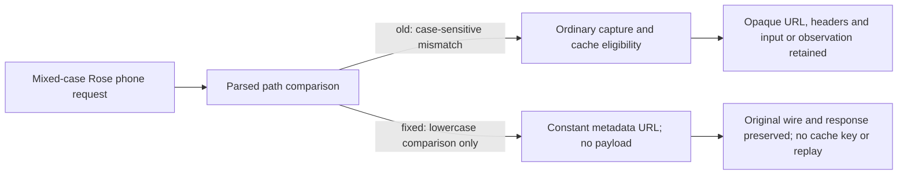

## Problem

Before live password testing, a synthetic canary passed through the real outbound
capture and capture HTTP endpoint. The captured response retained the control URL
and token, and the request retained typed input. The permanent regression failed
with `phone capabilities and credentials leaked into capture` on the old code.
No real password was used in this reproduction.

Command, from back-end: `bash scripts/run-blackbox-tests.sh phone-harness-capture`.
Pre-fix run: `1792350300-2224615-1003`, exit 1. The unchanged test passed after
the fix in run `1792350512-2257008-17980`, exit 0. Both logs are retained in the
workspace's gitignored `.context/phone-harness/` evidence directory.

## Diagnosis

Critical path: provider request and response -> installed fetch wrapper ->
credential-exchange classification -> capture HTTP endpoint and replay cache.
The provider response must retain the private grant for its authorized caller;
the test confirms that boundary is correct. The first bad boundary was the
capture classification: it recognized OAuth exchanges but not the new phone
provider. Consequently generic capture retained capability paths and bodies,
and generic replay could substitute an old result for a physical operation.

The owned failure class is capture policy for capability-bearing, stateful
provider traffic. It is not an observability gap: the capture itself disclosed
the private data. A provider-wide metadata-only policy fixes creation grants,
control input, screen reads, failures, and replay together. No prompt change is
required.

## Solution

Classify the configured HTTPS Phone Harness origin as a private exchange.
Record only timing, method, status and a constant metadata URL; exclude headers,
bodies, response bodies, exception details, opaque URL paths and query strings.
Reuse the existing private-exchange branch to disable replay, preserving live
operation execution. The test asserts a private response reaches its caller,
canaries do not reach capture or replay keys, and repeated inputs execute twice.

The normal backend runner discovers the test by its `.blackbox.ts` name; deploy
Step 4a runs that runner under coverage. Existing capture and provider unit
regressions also passed (81 tests). At 10k agents classification performs constant
work per exchange, stores no private payload, and introduces no shared lock,
subscription or per-user fan-in.

A follow-up exercised the Rose API hop with the same canary mechanism. Run
`1792351893-2491876-3382` failed because `/api/iphone/.../operations` retained
request and response bodies even though direct provider traffic was private.
The unchanged expanded test passed in `1792351933-2498388-20750` after classifying
the exact phone API path and subpaths as private too. It now asserts six real
upstream calls, including repeated first-party inputs, and private replay keys
for both hops. The existing capture unit regressions also passed (2 tests).

## Goal 6a recurrence — Python route-equivalent casing

This is a recurrence of the private-exchange capture/replay class in the Python
Rose HTTP hop. The earlier backend fix already lowercases its parsed path. The
Python implementation and its tests covered only lowercase paths, so the guard
failed to cover valid case variants rather than regressing the backend code.
No real password has been provided; all values below are unregistered synthetic
canaries, not known secret references. No external service or live phone was used.

### Evidence and first bad boundary

At checkpoint `3a3d25f3b42a5ab801e40f00476e6669ad15b880`, both
`helpers/httpx_capture.py` and `providers/fast_cache/browser_http.py` compare
parsed paths to `/api/iphone` case-sensitively. Installed Express constructs its
router from `this.enabled('case sensitive routing')`
(`node_modules/express/lib/application.js:147`), with no enabling override in the
Rose server. Thus route-equivalent `/API/IPHONE` or `/Api/Iphone/...` does not
receive the Python private-route treatment.

Archive searches were `phone transport capture privacy mixed case` and
`case insensitive routing metadata capture secret`; this case's existing solution
and feedback, plus the private-stream case, were read before the correction.
The exact hypothesis, now proven: case-sensitive classification lets a request
on the private phone namespace enter ordinary capture and replay, before any
secret registration or masking can help. The full request reaches the authorized
transport correctly; classification, not phone execution, is the first bad boundary.

### Owning reproduction and narrow correction

Two tests were added to the existing `httpx_capture.blackbox.py` BlackboxResult
registration **before** changing either classifier. Exact identical command,
from agents after `source venv/bin/activate`:
`python scripts/run_blackbox_tests.py httpx_capture`.

Red normal run `20261018-213741-3892852-05640316`: 8 existing checks passed,
2 new checks failed with `Mixed-case phone capture leaked unregistered secret`
and `Mixed-case phone traffic remains replayable`; runner exit 1. Evidence:
`.context/phone-harness/goal6a-phone-case-red.log` and the normal artifact directory
`.context/test-runs/20261018-213741-3892852-05640316`.

Fix: lowercase only `request.url.path` / `urlsplit(url).path` for the two existing
namespace comparisons. Keep exact namespace-or-slash boundary matching. Do not
rewrite the request URL, host, query, fragment, credentials, headers, body or
response, and do not expand ordinary capture policy. No shared state, fallback,
new redactor, schema, prompt or dependency was introduced. This is normalization
at the existing policy boundary rather than a second filter after disclosure.

The unchanged command passed all 10 checks in normal run
`20261018-213805-3896717-69a7c19f`, exit 0, 0.6s. Green log:
`.context/phone-harness/goal6a-phone-case-green.log`. Runtime source was frozen
at this green revision; later actions only run checks and record evidence.

The new transport check exercises `/API/IPHONE`, its trailing slash, mixed-case
lease operations and frame paths, with unregistered canaries in opaque paths,
userinfo, query, fragment, headers, input and a non-2xx response. Real httpx
request/transport objects preserve original path and payload casing; the caller
receives the exact 503 body/header values. Captures contain one constant URL,
empty headers, no request/response body, and status/timing only. Transport errors
that echo canaries become generic both in capture and caller traceback.
`/api/iphone-other` and its mixed-case spelling retain ordinary body/URL capture.

The second check covers GET/fetch, HEAD/document and POST/xhr: private variants
cannot reach cache lookup, cache write, key generation or cache logging.
Lookalike non-phone paths retain normal GET/POST eligibility. Existing lowercase
checks remain unchanged. All assertions are in the normal recurring suite,
not a scratch runner or a test that depends on workspace-private files.

### References, validation and limits

The closest concrete reference is Rose's existing backend
`back-end/src/providers/fetchCapture.ts:170`, which lowercases only the parsed
path before the same private-namespace comparison. Reference harness searches
also covered Claude Code URL/HTTP utilities, Codex network/redaction modules,
OpenClaw logging redaction and Hermes web caching. OpenClaw
`src/logging/redact.ts:289` normalizes sensitive key names before classification;
Hermes `tools/web_result_cache.py:215` normalizes host names before case-insensitive
cache-exemption matching. Neither is an exact Rose phone-path implementation;
no external-harness behavior substitutes for the executed reproduction.

Additional commands from the activated agents environment:
- `python -m pytest -q tests/fast_cache/test_browser_cache.py`: 17 passed, 0.49s;
  `.context/phone-harness/goal6a-browser-cache-adjacent.log`.
- `python scripts/run_blackbox_tests.py fast-cache-client`: 5 checks passed,
  normal domain exit 0, 1.1s;
  `.context/phone-harness/goal6a-fast-cache-normal.log`.
- `/home/boxes/.local/bin/uvx --offline ruff check agents/helpers/httpx_capture.py agents/providers/fast_cache/browser_http.py agents/tests/blackbox/httpx_capture.blackbox.py`
  from repository root: all checks passed;
  `.context/phone-harness/goal6a-phone-case-ruff.log`.

The 10k-agent cost is one parsed-path lowercase operation per request, with no
new map, background task, subscription, database read or per-user fan-in. This
fix proves only the mixed-case capture/replay boundary. It does not establish
all raw password/OTP privacy, private input-result echo safety, realtime/media
redaction, native account binding, attention handoff, or percent-encoded route
variants. Those remain separate parent-owned gates before credential entry.
No runtime image rebuild, live benchmark, provider/CLI action, deployment,
commit or production query was performed. INDEX remains parent-owned.

## Human feedback

For Goal 6a, the parent required normal registered red-before-green canary proof,
original wire/response preservation, prefix-negative controls, no known-secret
registration dependency, a minimal path-only fix, source freeze on green, and
no claim that all credential privacy is complete. Freedom and protected
instructions were preserved. Earlier backend incident had no recorded feedback.

## Reusable lesson

Exclude stateful capability-bearing provider exchanges from payload capture and replay before using real credentials.
