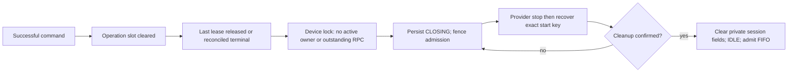

## Problem

Parent-reported live evidence at 20:11 UTC: canonical local cloud-devbox run
`.context/benchmarks/phone-connectivity-20261018t2006` successfully executed
Rose apps.launch and screen.text, then released the logical lease. SQL showed
providerState READY with providerStartKey, providerSessionId and
providerSessionEncrypted still nonnull. No attention request was involved.
This investigation did not query or mutate that active benchmark database,
read phone secrets, call a live phone provider, or signal its processes.

The backend owning-boundary reproduction uses actual routes, Prisma, and the
existing HTTP fake provider on the normal independently started port 3101
backend/default test database. Exact command from back-end, unchanged red/green:
`bash scripts/run-blackbox-tests.sh iphone-control`.
Red run 1792354368-2915534-12575: 18/20 passed, exit 1. New failures:
`Successful idle session was not stopped` and `'READY' !== 'CLOSING'`.
Logs: `.context/phone-harness/idle-cleanup-red.log` and its recorded test-run
runner.log. Initial unchanged green run 1792354398-2922819-17270:
20/20 passed, exit 0 (domain 6741 ms; red domain 6589 ms).
Additional fence-at-stop and terminal-agent regressions were added afterward.
Final same-command run 1792354478-2942296-3856 passed 21/21, exit 0,
domain 6417 ms. iphone queue passed 28/28 in combined run
1792354420-2928412-18422. TypeScript --noEmit passed; scoped ESLint passed.
The combined run exposed an interactions fixture contract mismatch at line 179:
WAITING rather than expected ACTIVE after release. Its fake provider remained
cleanupComplete=false throughout. Parent explicitly granted the positive fixture
setup before release, preserving every assertion. Follow-up combined run
1792354696-2992181-27112 passed control 21/21 and queue 28/28 but revealed a second
fixture false positive: the later uncertain mutation expected UNKNOWN and got
FAILED (interactions line 223). The global cleanupComplete=true flag leaked into
new-session responses. Scope that positive flag to the release only, restoring
false immediately afterward; no assertions, production behavior, or denied-path
expectations changed. Both false-positive logs are retained under
.context/phone-harness/idle-cleanup-approved-verification.log.
Final normal command from back-end:
`bash scripts/run-blackbox-tests.sh iphone-interactions,iphone-control,iphone`
Run 1792354739-3004837-22604 exited 0: interactions 12/12 (2094 ms),
control 21/21 (6360 ms), queue 28/28 (6949 ms). All assertions unchanged.
Log: .context/phone-harness/idle-cleanup-approved-verification-final.log.
The earlier flag-leak rejection is explained by phoneHarness.ts control()
rejecting a session whose cleanupComplete=true; resetting the positive test
setup restores the intended live-session fixture for subsequent cases.
Scoped ESLint and prettier checks passed after the final two setup lines;
full backend tsc --noEmit passed during this verification.
Normal archive validate reports only stale INDEX.md (parent owns reindex).
Archive case schemas validate against an isolated generated index preview.

## Diagnosis

Archive searches: `phone cleanup successful idle session` and
`lease released provider READY cleanupCandidate`. Read the phone cleanup
before authorization case, its solution and feedback. This is a relative,
not a recurrence: ownership ordering remains intact; the omitted lifetime
is the successful operation's still-live session. Git history inspected for
repo.operations and phone branches; current phone lifecycle originated in
e3bd9a752, with browser interaction changes in 2b1fdeb60.

Explicit hypothesis, proven by the unchanged red/green reproduction:
- What: releasing the final successful lease leaves a READY physical session.
- Where: repo.operations.cleanupCandidate returns null when no active operation exists.
- Why: finishCommand clears the command slot on success, while session custody
  survives; cleanup wrongly equated session lifetime with pending command lifetime.
- Proof: actual successful route command, release, missing provider DELETE and
  READY database state on old code; same assertions pass after candidate repair.
- Problem: persistent resource cleanup eligibility depended on a shorter-lived
  child operation instead of durable owner/session custody. Expiry and terminal
  agents share the same omitted idle-session path.

Binary search: command execution and success receipt are correct; logical
release is correct; session cleanup selection is the first missing boundary.
The deepest owned gap is missing ownerless-session eligibility, not a provider
failure or benchmark criterion. A broad unconditional stop would break valid
active/FIFO owners and is rejected.

Golden reference: `codex/codex-rs/core/src/unified_exec/process_manager.rs:653`
uses terminate_confirmed before treating an owned process as ended. This fix
converges on confirmed resource termination while retaining Rose's durable
provider recovery receipts and per-device lock; it copies no process logic.

## Solution

Extend cleanupCandidate's null-operation branch under the existing device lock:
require an existing start key, no ACTIVE logical lease, and no CONNECTING/RUNNING
RPC. Commit CLOSING before provider stop. Admission checks CLOSING and execution
rechecks it before physical input. Reuse stopAndConfirm and confirmCleanup to
retain the original key/private capability until recover reports cleanupComplete.
The service handles a nullable candidate operation. An already admitted valid
FIFO successor keeps the current session; invalid/foreign releases still fail
ownership checks before provider effects.

Permanent coverage lives in iphone-control.cleanup.cases.ts, imported by the
existing iphone-control cases and discovered through iphone-control.blackbox.ts.
The normal backend runner discovers *.blackbox.ts (run.ts:29); /deploy backend
coverage invokes scripts/run-coverage.sh, which runs this normal suite.
Tests include positive stop/recovery and private-field erasure, CLOSING before
DELETE, controlled incomplete cleanup fencing commands/replacement sessions,
invalid/foreign release isolation, valid active/FIFO owner retention, stale
release after handoff, and terminal-agent cleanup. Existing unknown/inflight
control cases remain unchanged.

10k-agent behavior: indexed device-scoped lookups inside the existing device
lock; no fleet scan, polling loop, background worker, provider fanout, or
cross-account lock. Provider IO stays outside transactions. Pending proof
retains custody instead of spawning another physical session.

Outcome gate remains OPEN: parent owns the exact unchanged canonical live task
rerun and its durable evidence. Backend fake-provider green proves causality,
not the live benchmark outcome. No benchmark evaluator, guard, prompt, timeout,
fixture, Python runtime, or schema was changed here. No deploy/commit performed.

Safe retained-stack handoff: parent retains old-stack authority and will use a
patched sidecar backend against the same isolated database with its canonical
cleanup_phone helper. This investigation takes no live action. The supported
authenticated Rose
GET /api/iphone/leases/<exact-owned-lease-id> (or repeat POST .../release).
The owned request drives reconciliation and exact session stop/recovery. Poll
the same supported route until phone.cleanup_complete and confirm device IDLE
with all three session fields null before allowing the parent cleanup guard to
drop durable state. Incomplete cleanup must retain the stack; do not directly
invoke provider CLI/API or rewrite session fields. Then parent reruns the exact
canonical task unchanged.

The parent subsequently loaded the tested fix in an owned temporary backend
against the retained isolated database. The existing benchmark cleanup helper
called the authenticated Rose API and confirmed both leases terminal, the
provider IDLE and all session fields cleared at 20:19 UTC. The temporary
backend exited normally. The private recovery-receipt.json records that real
recovery; the original failed attempt remains failed. Full unchanged-task
verification remains pending.

## Unchanged canonical outcome verification — 2026-10-18

The prior OPEN handoff statements above describe the evidence available then;
the unchanged native outcome gate is now closed. Parent ran the normal command
`bash scripts/run-bench --local browser-cloud-iphone-settings --run-id phone-connectivity-20261018t2042-r2 --no-dashboard`
at checkpoint `379cd490cf75ec87fa4cfbbc179f0222c429ee8d`. Its native controller
exited 0. Native run
`agents/benchmarks/runs/20261018_204540_75a7f70a-71c5-4929-87d9-6e772ae450d7_browser-cloud-iphone-settings.json`
records **PASSED**, COMPLETED, score 1, 177.3 seconds, 51 messages, and no failure.
The FINISHED canonical completion card reports typed `visible_heading` =
`Paired Computers`; the strict persisted launch/OCR/heading and no-attention
checks passed. This is actual Rose/cloud-phone evidence, not a replay verdict.

Original trigger: `2026-10-18T20:06:57.416731+00:00`; third-attempt trigger:
`2026-10-18T20:41:34.224899+00:00`. Hub:
`75a7f70a-71c5-4929-87d9-6e772ae450d7`; root:
`b53db629-4b68-4d7a-b763-1777d3b15f45`. The original ERROR and second FAIL
remain failures; the third PASS does not rewrite either. The original
controller's finalizer lost its native completed run/ledger row. A source-tagged
ERROR row was appended to `history/task_attempts.jsonl`, preserving every prior
byte. Its 457-second duration is explicitly the rounded original report display,
not an invented exact tenth; timestamp comes from the original local Hub run.
No token counts were inferred. Backfill provenance:
`.context/phone-harness/goal4-close-history-backfill.json`.

`tasks.py` does not exist in this benchmark package; the authoritative
`agents/benchmarks/tasks.json` is byte-identical from `33bf65449502dd377dec57f576f8590bdb091d71`
through `379cd490cf75ec87fa4cfbbc179f0222c429ee8d`, SHA256
`711a7f0f0e05db71042792751fbb7e1ad3c347285a943d0789a7cf93059363b8`.
All six recorded runtime hashes in
`.context/phone-harness/live-connectivity-retry2-slice.json` match both the pass
checkpoint and closure-time checkout. Verification receipt:
`.context/phone-harness/goal4-close-frozen-proof.json`. These are bug fixes under
unchanged task criteria, not a claim that all runtime files match the buggy revision.

Parent's retry log records cleanup `started=2 completed=2 state=clean`.
Both task and local-stack receipts are clean, and local-benchmark-owner state is
`cleanup_verified`. No resource stop acknowledgment substitutes for this proof.
The real canonical publisher completed; fresh-browser FE verification saw all
51 messages and retained browser termination/recording checks. The rendered dump
was published to HTTPS and its recorded readback returned 200. Exact verified
share/HTTPS links and canonical HTML are retained in
`/opt/cursor/artifacts/rca_evidence/b53db629-4b68-4d7a-b763-1777d3b15f45/manifest.json`;
publication log: `.context/phone-harness/live-pass-publication.log`.
Independent closure readback also returned HTTP 200 for the 39,048-byte HTML;
`.context/phone-harness/goal4-close-outcome-proof.json` records its hash, native
PASS/FAIL hashes and three preserved attempt rows without copying signed URLs.
The second attempt's separately published FAIL remains unchanged.

This closure ran no additional paid benchmark, live phone operation, deploy,
commit or process intervention. Goal 5 frontend work is independent of this
Goal 4 proof; it is not included in this result.

The existing 12 interaction / 21 control / 28 queue owning assertions and their
recorded red/green remain the causal proof; the native clean receipts now supply
the previously missing real-session outcome proof. Backend tests were not rerun
by this documentation/publication closure.

## Human feedback

User required test-first proof, independent default3101 blackboxes, preservation
of the active checkpoint/run, no live cleanup, no provider calls/secrets,
Freedom/AGENTS preservation, narrow backend ownership, no commits/deploy/spawn,
and parent-owned exact benchmark rerun and archive reindex. Parent subsequently
authorized the positive interactions fixture setup; the shared fake flag is
restored immediately after that intended positive cleanup. These constraints
supersede the RCA workflow's default deploy/reindex actions.

## Reusable lesson

Fence and confirm cleanup of persistent sessions from durable ownership, independently of whether their last operation still occupies a command slot.
