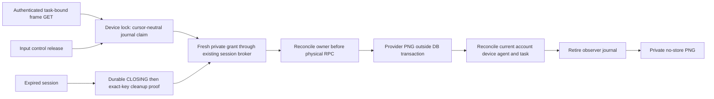

## Problem

Goal 5 native-overlay review used actual Rose routes, Prisma and the existing
HTTP fake phone provider through the normal backend blackbox runner on its
independent default port 3101/local test database. No live phone provider,
onboarding, iCloud or messages operations were performed. Goal 4's parent-proven
canonical browser-cloud-iphone-settings PASS at commit 379cd490c and root
b53db629 remains baseline evidence, not proof of this new overlay behavior.

Before implementation, the intended assertions and context diagram were sent
in commentary; API findings were sent directly to the managed UI worker. Root
clarified that no new bounds/view endpoint was necessary. Final contract stays
on GET frame and normal routed POST screen.bounds after user takeover.

## Diagnosis

Archive searches: `phone frame takeover grant expired` and `phone concurrent
read control ownership`. Read prior phone cleanup authorization/privacy and
unused-browser phone-lock cases; these are relatives, not recurrences. Their
ownership-first behavior and unused-task fast path remain intact. Completed
plans were searched for this domain; browser-auth-credential-model supplied the
related private-credential and pending-auth handoff constraints. Current phone
domain history and local upstream skill/wire contract were inspected.

Explicit hypothesis, confirmed by route-level red/green:
- What: cold/expired frames fail, ownership can change while pixels are in
  flight, and revoked task/account/device/root ownership can still return pixels.
- Where: direct cached-session phoneFrame and mutation-slot-only lifecycle checks.
- Why: a read-only UI observation was treated as outside physical RPC custody;
  cached readiness checked session TTL but omitted the control grant's TTL.
- Proof: normal owning tests fail on cold frame, expired grant, live-frame
  takeover, late revocation and supplemental-read cleanup, then pass unchanged.
- Problem: logical ownership and physical RPC lifetime must cover observations,
  session preparation and cleanup as well as mutating commands, without turning
  passive frames into agent decision history.

Binary search localized missing custody before frame transport, incomplete grant
freshness before session reuse, and missing current authorization before PNG
publication. The request's initial auth was correct; the delayed response was
not revalidated. A supplemental read could occupy no activeDeviceId and escape
cleanup fencing. A CONNECTING duplicate could start a second readiness RPC
under the same command row, so journal state alone did not imply one live
preparation request. Queue UI separately counted dead waiters despite lazy
promotion cleanup; it needed a live-agent count filter, not eager waiter locks.

Golden reference: the local existing command broker's device lock,
beginExecution and keyed cleanup receipts are the authoritative protocol reused
by the observation path. No external harness was copied; unrelated browser
session code is not a physical-phone custody reference.

## Solution

Keep all existing public endpoint shapes and no schema/Zod edits:
- GET /leases/:id/frame can cold-bootstrap and refresh a private grant. User
  frames require the lease's persisted browser task to belong to that account
  and agent. Internal diagnostic leases retain their prior supported access.
- Frames get bounded durable CONNECTING/RUNNING custody but never advance
  actionCursor or lastOperation. Retire their ephemeral row after the RPC;
  filter screen.frame from public pendingOperation so tabs never poll a retired
  transient receipt. Return PNG with private, no-store and nosniff headers.
- Check both grant/session freshness. Refresh a control grant through the same
  start key without stopping a fresh session. For session expiry, persist CLOSING
  before stop and retain the original key until confirmed cleanup. Preserve a
  still-executing CONNECTING operation through synchronous cleanup proof. If
  preparation settles not-ready, return a terminal rejected receipt before any input.
- Every live read/frame joins input and control fences. Cleanup confirmation
  fences supplemental reads too. Reconcile account/device/agent/task ownership
  again before physical execution and before publishing late pixels.
- Same-ID CONNECTING duplicates return their receipt while preparation is live.
  A settled pre-execution not-ready attempt becomes FAILED with safe constant
  code phone_connection_not_ready and result success=false/outcome=rejected.
  Free its command slot but retain the provider key/CLOSING fence. That stable
  ID stays terminal forever; status GET stays read-only and frames may recover
  the same session key. A distinct explicit ready intent may execute once.
  RUNNING/UNKNOWN never replay. Abandoned still-live preparation remains under
  the existing deadline/cleanup quarantine, not a parallel readiness attempt.
- User takeover is retained through the agent heartbeat deadline. Only the
  authenticated user can hand it back; handback refreshes the agent deadline.
  Terminal agents, revocation, auth rejection and explicit release still reconcile;
  pending auth retains the existing behavior. Raw /leases allocation requires
  internal auth; UI task interactions derive agent identity server-side.
- Queue position filters dead/deleted agents within the existing per-device,
  earlier-ticket count. Dead-waiter cleanup remains off the live-owner heartbeat.

Actual provider point bounds are returned by normal routed screen.bounds after
user takeover. Local upstream-skill.md lines 297/322 specifies {x,y,w,h,id} or
null and point units; no image-pixel hardcodes or new metadata endpoint were added.

Cohesive session-key transitions moved to repo.session.ts and observation
retirement to repo.view.ts, preserving normal module size limits without lint
exclusions. Existing positive control/queue handback fixtures now authenticate
as the user; all original assertions remain. The existing Andy/deferred-account
assertions moved into the existing boundary cases module to retain file limits.

Executed proof (commands from back-end):
1. `bash scripts/run-blackbox-tests.sh iphone-control` red run
   1792356725-3386249-14787: 21/28, seven new failures; unchanged assertions green.
2. Same command, held revocation/session-expiry cases, red run
   1792357030-3443858-33: 28/33; all five late-authorization/closing assertions green.
3. Same command, duplicate preparation, red run 1792357323-3499081-25610:
   33/34, parallel readiness RPC assertion; unchanged green 34/34.
4. `bash scripts/run-blackbox-tests.sh iphone-interactions` red run
   1792357162-3469319-15071: ephemeral frame exposed in pendingOperation;
   unchanged green run 1792357212-3478749-21764: 13/13.
5. `bash scripts/run-blackbox-tests.sh iphone` red run
   1792357346-3503660-26127: 28/30, dead/deleted waiter counts; unchanged green.
6. Final `bash scripts/run-blackbox-tests.sh iphone-control,iphone,iphone-interactions`
   run 1792357447-3523241-24194: 34/34 control, 30/30 queue, 13/13 interactions,
   exit 0 before the final status-only client correction. Domain times
   10149/7517/2492 ms. Logs retained under
   .context/phone-harness/goal5-*.log and the exact .context/test-runs directories.
7. Parent/UI review found that status-only clients would not resubmit a deferred
   CONNECTING intent. New actual-route liveness test first failed 34/35 in run
   1792357605-3551909-30642 (`Settled preparation stranded a CONNECTING intent`).
   Parent accepted terminal pre-execution rejection instead of GET-side input
   execution or client-side mutation retries. The older missing-receipt and
   expiry tests' CONNECTING/resume assumptions were intentionally corrected;
   all original-key, one-provider-session, no-input-before-cleanup and single
   explicit ready execution assertions remain and stable failed-ID checks were
   strengthened. One newly reachable fixture assertion incorrectly compared
   the shared harness's cumulative physical-op count to zero; the recorded
   18!=0 false positive was fixed to assert zero delta for this exact fixture,
   preserving the no-input requirement. No production safety assertion weakened.
8. Final normal combined run 1792357718-3573732-8370 exits 0: control35/35,
   queue30/30, interactions13 cases (10244/7477/2641 ms). The interactions test
   printer still hardcoded a denominator of 12; replace it with a counted total
   so added owning checks cannot leave a misleading summary. Assertions unchanged.
9. After the reporting-only fix, interactions run 1792357814-3592621-21260
   exits 0 and prints 13/13; its scoped lint/format pass.
10. Normal build, scoped ESLint/Prettier, 79 provider-client unit tests, 1597 layer
   dependency checks, blackbox case registration and git diff checks passed.

Coverage is permanently imported by existing iphone-control/iphone/interactions
blackbox domains. The normal runner discovers these domains; backend coverage
and /deploy reuse that runner. No separate test framework or changed criteria.

10k behavior: constant indexed device/task/agent lookups per request, no per-user
channel, all-agent scan, shared in-memory lock or queued-agent lock fan-in. One
physical device intentionally serializes its RPCs; settled frame rows are deleted
rather than building per-frame history. Duplicate preparation does not fan out.
Provider IO remains outside DB transactions. Queue count uses the existing
bounded per-device index/filter and takes no waiter row locks.

Parent verification completed at checkpoint 05351394c7c7f1295579e314b28781d270c28604.
The exact unchanged canonical command `scripts/run-bench --local browser-cloud-iphone-settings`
(run ID phone-connectivity-20261018t2119-r3) returned native PASS in 146.4 seconds:
Hub a539faa3-74c9-47c0-80b1-d37119c71400, root
49e6acd8-e821-4121-9a18-ccb035d0b0c9. Task definition SHA256 remained
711a7f0f0e05db71042792751fbb7e1ad3c347285a943d0789a7cf93059363b8.
A concurrent authenticated first-party UI observer received actual private,
no-store PNG bytes (750x1334) with zero phone writes and no browser errors;
proof and desktop/mobile captures are in .context/phone-harness/goal5-live-view/.
An initial 409 during custody contention was followed by a successful frame;
no control transition or model operation was issued by that observer.
Phone cleanup was clean 2/2 and the owned stack was released. Canonical evidence
publication verified 42 messages in a fresh browser and the published LLM dump;
manifest is /opt/cursor/artifacts/rca_evidence/49e6acd8-e821-4121-9a18-ccb035d0b0c9/manifest.json.
All historical native ERROR/FAIL outcomes remain in the original logical slice.

The full frontend coverage gate passed 168 files, 2832 tests, with 3 existing
skips, and its production build passed. The actual full-app mobile screenshot
revealed a separate global account-rail layout issue; that frontend issue has
its own owning regression and does not alter this custody fix or native PASS.
This case is FIXED for backend custody. It does not claim iCloud onboarding,
message synchronization or final frontend pixel verification.

## Human feedback

The parent delegated Goal 5 backend/provider/owning blackboxes with
assertions-first diagrams and normal red/green proof; preserve Freedom/AGENTS,
Andy-only scope, backend-only key custody and prior Goal 4 PASS. Root/UI workers
clarified no new view/bounds endpoint, cursor-neutral frames, all-RPC accounting,
late owner revalidation, transient pending-operation filtering, live queue
positions and a terminal pre-execution rejection contract for status-only clients. Those review findings received owning red/green tests. Root owns
visual QA, shared index, final evidence and commits.

## Reusable lesson

Include observations and session preparation in durable physical-resource custody while keeping passive view lifetimes out of agent decision receipts.
