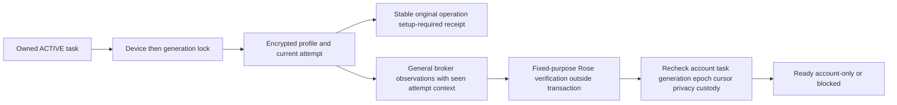

## Problem

During first-use setup implementation, the registered normal route suite reproduced
profile admission while an UNKNOWN physical operation had no active slot, and
reuse of an obsolete setup attempt after workflow generation changed on the same
ACTIVE lease. No actual Apple identity, password, paid model or live provider was
used. Tests use authenticated routes, Prisma and existing provider fakes.

## Diagnosis

Archive searches: `phone_setup_required UNKNOWN setup profile` and
`workflow generation setup claim stale`, captured in
`.context/phone-harness/goal6c-rca-search.log`. Related browser custody/profile
cases are leads; this is a new native setup boundary. The existing native phone
attention case documents device-first locks and exact task ownership, retained here.

H1: checking only activeDeviceId/CONNECTING/RUNNING misses a retained UNKNOWN
journal. Prediction: internal profile PUT returns200 for UNKNOWN with null slot.
Falsifier: same normal route rejects409 without altering profile. Executed red
`.context/phone-harness/goal6c-verifier-red.log` (46/48) and
`goal6c-generation-red.log` (47/49) confirmed the admission omission.

H2: lease-only attempt reuse cannot fence a replacement workflow generation.
Prediction: fresh interaction keeps obsolete attempt ID. Falsifier: same active
lease receives a new revision/attempt after generation changes. Independent case
in `goal6c-generation-red.log` confirmed H2 separately from UNKNOWN setup.

## Solution

Profile admission now checks the indexed UNKNOWN journal even without an active
slot; previously confirmed provider_session_ended tombstones are distinguished
from unresolved outcomes. Setup claim ownership includes workflow generation and
exact lease/task. All claims and commits use device-first locks. The bounded
single encrypted envelope stores profile/current attempt/latest verification;
existing setupState remains phase authority. Original setup-required intent stays
terminal forever. No original mutation is replayed after readiness.

Verifier input is 1..8 actual successful current-epoch screen.text receipts,
selected by lease/request key, sanitized through the private-value/media boundary,
with current contiguous cursor/freshness and post-attention floor checks. The
canonical Rose wrapper uses fixed account-sign-in purpose, 60-second AbortSignal,
actual model pricing/usage, and idempotent backend ToolUsage. Caller verdicts and
OCR are not accepted. An identifier in an editable sign-in form or account
suggestion is explicitly insufficient in the fixed purpose; this is semantic
verification, not an OCR keyword classifier.

## Verification

Exact normal owning command: `bash scripts/run-blackbox-tests.sh iphone-control`
from back-end. Initial first-use red41/43 in `goal6c-setup-red.log`; independent
fence red47/49 in `goal6c-generation-red.log`; unchanged gate green49/49 in
`goal6c-complete-control.log`.

Expanded final command:
`bash scripts/run-blackbox-tests.sh iphone-control,iphone,iphone-interactions,auth-assistance,iphone-rls,phone-harness-capture,attention-requests`.
Run1792362917-356150-20993: all seven domains pass, control54, queue30,
interactions13, auth37, RLS32. Log `goal6c-final-blackboxes.log`.
Held verdicts after epoch/generation/task deletion/private-phase changes cannot
commit Ready. False verdict stays unready. Ready survives cleanup/new successor
without re-verification. Stable retries call verifier once and bill once.

Canonical wrapper command:
`node --experimental-test-module-mocks --import tsx src/tests/unit/phone-harness-client.test.ts`.
Purpose assertion red79/80 (`goal6c-purpose-red.log`) before the exact purpose
sentence addition; unchanged command green80/80 (`goal6c-provider-units.log`).
Build, scoped ESLint/format and1650 layer assertions pass; detailed logs are under
`.context/phone-harness/goal6c-*`.

## Limits and pending review

Parent owns closure/reindex, canonical seed refresh, full frontend integration
and eventual approved real setup. No actual signed-in account has been verified.
Ready records account sign-in only, never sync/history/OTP readiness or perpetual
Apple attestation. Semantic false positives remain a model limitation; unknown,
masked or ambiguous evidence is instructed unconfirmed. Missing model/usage or
failed model IO blocks readiness; partial failed streams without authoritative
usage cannot invent a charge. LastRequest is a recovery pointer; exact operation
GET is authoritative after interrupted cleanup. No automatic retry/replay.

The unchanged canonical Settings evaluator rejects any FAILED or setup.* journal
row. Correct setup-required behavior therefore needs a parent-reviewed evaluator
adaptation before that benchmark can establish compatibility; benchmark/task/
fixture/prompt bytes were not changed or hidden. No benchmark success is claimed.

## Human feedback

None recorded. Parent technical review is evidence and engineering coordination,
not human feedback.

## Reusable lesson

Treat unresolved outcomes as custody, bind logical claims to the current generation, and recheck admitted context after asynchronous preparation before either physical execution or semantic commit.

## Adversarial pre-execution followup

Parent technical review required a normal route readiness-barrier reproduction before changing
production source. Actual fake-provider session create/get was held provisioning;
an admitted AGENT input.tap carried the seen setup attempt/revision. The same
agent workflow generation changed, a fresh interaction rotated the attempt, then
the readiness barrier was released.

H3: runClaim awaited session preparation but beginExecution only reconciled
lease/control/account, allowing obsolete setup custody to reach input.
Prediction: at least one physical input despite the changed generation/attempt.
Falsifier: zero input, terminal rejected original journal, and retry never executes.
The unchanged command `bash scripts/run-blackbox-tests.sh iphone-control` failed
54/55 before the fix, run1792363213-415730-2401, with
`Obsolete setup command reached physical input after readiness`.
Log `.context/phone-harness/goal6c-preexecution-red.log`.

The minimal correction retains a server-only admission generation snapshot in
CommandClaim. Immediately before CONNECTING->RUNNING, under the existing
device-first transaction and reconciled agent/account locks, it compares current
generation plus the original encrypted setup attempt/revision and exact lease/task.
A mismatch atomically writes FAILED phone_setup_stale, rejected outcome, completed
stamp and null active slot. No provider input is made. Ready/no-context AGENT
admission remains supported, USER/observer claims keep their existing boundaries.
The extracted command journal writer only preserves the existing admission write
and captures the internal snapshot; no caller fields, schema, prompt or benchmark
criteria changed. Duplicate/restart CONNECTING receipts are still cached-only and
never obtain a fresh execution snapshot or replay.

Same exact command green55/55, run1792363270-426253-12679, log
`.context/phone-harness/goal6c-preexecution-green.log`. The new assertion verifies
zero physical input, terminal FAILED phone_setup_stale, null active slot and
unchanged repeated operation rejection. The final seven-domain rerun uses the
extracted writer and is recorded in the backend full-result artifact.

## Parent review closure

The adversarial review identified the physical-start gap separately from the
semantic-commit tests; the recorded normal-route red and unchanged green above
resolve that finding. Final seven-domain run1792363311-434866-25003 passed control55,
queue30, interactions13, auth37, RLS32, capture and attention; provider80, layers1656,
build, lint and formatting also passed. The purpose-string test proves canonical
request construction, not live semantic accuracy; no live semantic failure or
semantic-model fix is claimed. Both local custody defects are closed. Full cloud
onboarding, semantic account verification and benchmark compatibility remain
separate outstanding feature-validation work.
