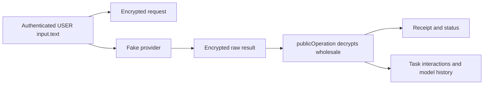

## Problem

An unregistered synthetic credential crossed the phone API disclosure boundary.

## Diagnosis

Base 3a3d25f3b42a5ab801e40f00476e6669ad15b880. Hypothesis H1: encrypted
storage is mistaken for disclosure control: publicOperation decrypts arbitrary
provider output without private classification. Prediction: a success echo of
fresh unregistered USER input.text appears in receipt/status/interactions while
raw database JSON contains no plaintext. Falsifier: these public surfaces omit
the canary without registering it with any redactor.

Confirmed by normal `bash scripts/run-blackbox-tests.sh iphone-control` from
back-end, run 1792359552-3909013-18518, exit 1, 35/36 passed. Only new test failed:
`Unregistered input exposed by: receipt,status,interaction`. Prior assertion
confirmed no plaintext in raw Prisma operation rows. Log:
`.context/phone-harness/goal6a-control-red.log`. No real password, private key,
Apple account or live provider used; actual authenticated routes and Prisma with
existing provider fake. Archive searches: phone unregistered secret provider echo
receipt; credential privacy OCR screenshot private phase. Related capture RCA
protects metadata capture, not API result serialization.

## Solution

Parent approved after actual red: server USER input.text classification; one
nullable encrypted device envelope, existing phone encryption, maximum 64 distinct
values / 16KiB UTF8, no TTL or eviction, reject capacity before physical input.
Device scope persists across restart, release and successor leases. No history
scan/global plaintext registry: one device-PK lookup and bounded envelope work;
existing per-device lock, no per-user agent fan-in at 10k.

Private phase denies model observations. Only authenticated USER handback may
clear phase; it never clears vault. Future exact phone attention completion will
own handback; auth/SMS changes excluded here. Known submitted text redacted before
result persistence and again at replay; USER input receipts constant. Raw model
screen.capture/media denied; owner taskbound private/no-store PNG unchanged.
Stable-ID, cursor and UNKNOWN custody must remain unchanged. New device column
requires canonical seed update, owned by parent. No Zod changes.

This protects submitted values, not arbitrary edits/transforms or unknown native
secrets. No native private-ref acceptance. Exact redaction alone cannot prove
pixel privacy. Later fresh OTP OCR must work after trusted handback with known
submitted values still masked.

## Human feedback

Parent required tests first, approved one encrypted device field after actual red,
and rejected broad media substring classifiers. Implementation uses only exact
documented screen.capture/screen.frame operation names and png_b64 payload key.

## Reusable lesson

Encryption at rest does not authorize decrypting arbitrary provider echoes into model history.

## Status

FIXED after parent review of the completed local fix. Goal6b/6c secure entry/resume and iCloud setup are separate gates, not prerequisites for proving this submitted-value boundary.
No live operations, secrets entered, commits or shared INDEX edits. Expanded owning
tests add replay/later OCR and unregistered transport-error positive control.

## Executed validation

Expanded pre-fix normal command reproduced receipt/status/interactions/stable replay
and later OCR disclosure: run 1792359666-3929576-29857, 36/37 passed; log
`.context/phone-harness/goal6a-privacy-red.log`. Phase-boundary red:
`.context/phone-harness/goal6a-boundaries-red.log`, 36/38 passed, internal frame
exposed private phase in addition to text leak. No production edit preceded these
runs. Stable-ID replay executed physical input exactly once in the red too.

Same normal control gate green after implementation, run
1792359764-3948791-13971. Expanded final normal gate
`bash scripts/run-blackbox-tests.sh iphone-control,iphone,iphone-interactions,phone-harness-capture`
passed all four domains, run1792359879-3970942-11053; log
`.context/phone-harness/goal6a-final-gates.log`. Control41, queue30, interactions13;
capture includes fresh generated canary and no replay. Final strengthened control
and real-migrations RLS32 gate passed run1792359925-3979869-7921, log
`.context/phone-harness/goal6a-final-control-rls.log`. The fresh worker subprocess
loads/decrypts durable state from Prisma with no inherited plaintext registry.
Tests inspect decrypted saved result envelopes, legacy encrypted result replay,
fragment concatenation, count/UTF8 capacity before any provider call, owner PNG,
raw media refusal, known-value masking with fresh different OTP after handback,
release/successor retention, malformed envelopes, and UNKNOWN physical fencing.

One positive test fixture needed cleanupComplete=false after the earlier session's
confirmed release. Leaving the fake's global cleanup proof true made the *new*
session immediately appear cleaned too. Only the intended successor live-session
setup changed; masking/OTP assertions were preserved. No safety guard weakened.

Production modules remain below300 lines; bounded recursive result processing
limits depth32/nodes20000 and provider wire already bounds response size. One
indexed device read for disclosure, existing device lock for vault admission and
result persistence; no operation-history scan or all-agent fan-in at10k.

Limits: values are exact submitted strings (including bounded joined fragments),
not a proof against arbitrary user edits/transforms, unknown native secrets or
pixel-derived secrets outside the protected phase. Owner-authenticated PNG stays
private and allowed. Parent reviewed and closed this submitted-value boundary; future exact phone attention/secure-entry/resume and live iCloud setup are separate Goal6b/6c gates. No password entered, provider
live call, deployment, commit or INDEX edit was performed by this worker.

Final relevant phone provider units:80/80 passed (`goal6a-phone-unit.log`). Build, relevant ESLint and Prettier passed; only RCA archive error is parent-owned INDEX freshness.

Final source-freeze control41 rerun passed run1792360058-4005749-16883, log `.context/phone-harness/goal6a-freeze-control.log`. No code changes followed.

Parent additionally verified full frontend coverage: 169 files, 2837 passed with 3 existing skips, 148.50 seconds, log .context/phone-harness/goal6a-frontend-full-coverage.log. Installed SDK privacy snapshots exclude the complete phone image/input/status subtree. This is local boundary proof; no claim of historical or live credential-recording privacy beyond the tested submitted-value contract. Canonical seed refresh remains a required preflight before the next owned stack.
