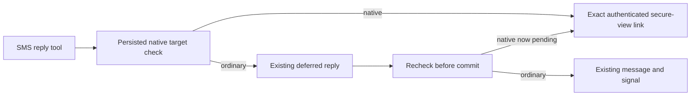

## Problem

Native phone attention requires protected entry and exact completion. The SMS
supervisor could queue or directly commit an ordinary reply to the same request,
including when the model omitted the attention ID. This was found with synthetic
input during feature implementation; no real password or live SMS was used.

## Diagnosis

Path: SMS supervisor reply tool -> deferred commit -> USER message and Temporal
signal -> direct attention update. This path bypasses the HTTP attention guards.
The first bad boundary was accepting a generic reply for a persisted native
phone target. Adding a guard only to attention/respond cannot protect this path.

Hypothesis: typed native attention has no policy check in either deferred-write
admission or commit. Prediction: fresh synthetic text is accepted through both,
and a reply without an ID is also admitted while this agent has native attention.
Falsifier: all three refuse without writes/signals and return the exact secure
request link on unchanged production.

Executed from back-end: `bash scripts/run-blackbox-tests.sh sms-supervisor`.
Before fix, run1792360846-4149942-17361 exited1, 48/51 passed; all three new
dispatch/commit/no-id cases failed `Native phone SMS reply must use the secure
view`. Artifacts: `.context/phone-harness/goal6b-sms-supervisor-red.log` and the
normal run directory. Existing browser/ordinary SMS cases passed.

Archive searches: `SMS native phone attention private user message` and
`supervisor reply bypass auth assistance completion`. The paused-SMS-reply case
is a relative: it also establishes that channel-specific writes bypass web
lifecycle behavior. This is a new typed phone boundary, not a recurrence of its
resume bug or the phone operation-result disclosure case.

## Solution

One shared provider checks the explicitly addressed native request, or an owned
pending native target for this agent when the ID is omitted. Both admission and
commit refuse with the exact agent/task/attention link. No text classifier or
credential guessing. Reply tool logs omit message bodies. Ordinary SMS behavior
is preserved. A coherent extraction of the existing budget commit keeps the
original600-line lint cap without exclusions or behavior changes.

Same normal command after fix, run1792360897-4161113-18844, exited0, 51/51.
Final rerun after extraction, run1792360956-4174366-18361, exited0, 51/51.
The unchanged assertions check no deferred write, no authored USER message,
unchanged attention, no workflow signal, no echoed input and the exact secure
link. These cases are imported by the existing sms-supervisor blackbox runner,
which the normal deploy backend gate executes. Scoped ESLint passed without
suppression; exact-link lifecycle unit passed before and after extraction.

This guards forwarding and completion at the agent boundary. It does not claim
that unsolicited passwords sent to the general SMS inbox are absent from SMS
provider records, inbound logs or the SMS supervisor transcript. The product
requests private entry only in the secure phone form. No live credential test,
provider call, deployment or historical exposure claim is part of this proof.

## Human feedback

The user requested browser-style attention at critical phone authentication
steps, including review of the SMS path. No additional user correction occurred.

## Reusable lesson

Protect typed private interactions at every channel's mutation boundary; an HTTP
guard cannot protect a separate direct-write adapter.

## Status

FIXED locally with executed normal-suite red/green and registered regression.
Live native attention and iCloud sign-in remain separate Goal6b/6c validation.
