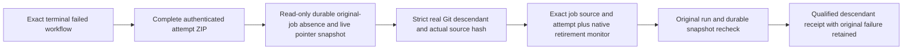

## Problem

The original run failed during the Docker npm install, before enqueue. Its
recovery job reported no queued worker deployment. Its failed CI conclusion,
original attempt/token and absent original job remain historical facts. The
underlying npm stall is UNKNOWN under separate repair owner
ph7955skk4fgpy41yq96701s5d8jb7q8; this qualifier does not repair that stall.

The verifier refused before inspecting an independently verified live strict
Git descendant. Reproduction on source 874e297769f98d80621d3d02f3245ea8b25a8308
(including merged parser repair f14f0cc030) failed at the exact no-job refusal
before implementation. Original and root regression failure receipts are
retained in the PR2289 private preservation archive.

## Diagnosis

The first bad boundary was unconditional original job recovery, before the
existing physical verifier could inspect qualified descendant evidence.

## Solution

A terminal failed workflow may enter this path only when the complete exact
attempt archive is readable, ZIP integrity passes, no queued identity appears,
and recovery names the source-bound app. A new read-only CLI queries all
original-source jobs, including terminal ones, and the pointer's durable job.
That job must be SUCCEEDED in the same app, name a strict Git descendant and
match the hash computed from that source's own algorithm and Python files.
Git replacement objects are disabled for identity-bearing reads. The existing
exact source/attempt monitor must verify qualified retirement normally.

After the monitor, the verifier rechecks the original run's source, terminal
status, conclusion and attempt, then repeats the durable snapshot. A new
original job, moved pointer or changed live job fails closed. This is a bounded
physical observation, not a guarantee that production never changes later.
No workflow rerun, enqueue, resume, resource mutation or timeout change occurs.
Workflow migration uses the qualified live source/attempt, while the original
CI identity remains unchanged. The lane reports verified-by-descendant rather
than an exact-source PASS.

## Validation and remaining acceptance

The existing production CLI fixture covers valid qualification and refusal of
active/changed attempts, original jobs, incomplete logs/archives, unreadable
snapshots, foreign/equal/unrelated/missing sources, hash/attempt/pointer
mismatches, pointer races and failed retirement verification. Real replacement
refs cannot substitute the app or hash source. The existing isolated Postgres
worker-deployment queue suite exercises the actual reader, includes a terminal
original job, compares unchanged durable records, and rejects missing CLI args.
Five unchanged focused runs, full selected native gates, fresh adversarial
review and merged production qualification are required before closing this
case. An unmerged diagnostic is supporting evidence only.

The added CLI and tests do not match the committed deploy-agents push filter;
this tooling release must not launch a worker cutover. Both original webdecoy
runtime incidents and their repair owners remain independent open history.

## Human feedback

The coordinator required an actual supported production qualifier, preserving
the original failed workflow and absent job, with no competing cutover. Fresh
adversarial review identified Git replacement reads and post-monitor snapshot
races; both received explicit regression controls before source acceptance.

## Reusable lesson

Separate original execution history from positive physical descendant proof.
An absent job must require complete authenticated logs and durable evidence,
and every source/identity proof must use the real immutable Git objects.

## Repair validation regressions

Native validation preserved three introduced repair failures rather than
relabeling them as passing: malformed case metadata, duplicate module-level
_gh_text overload definitions, and the migration structural assertion for
the exact merged SHA/token path. The case schema was corrected with the
unchanged archive validator. The existing unique-definition assertion first
failed, then passed with separately named byte/text wrappers and a shared
low-level body identical to the original subprocess implementation. A first
wrapper proposal changed stderr decoding; independent review rejected it,
and the accepted proposal preserves stdout, stderr, newline, error, token-pool
fallback and timeout behavior. Its unchanged full owning unit passed.

Migration now has a guarded qualified-descendant branch and retains the
original normal source/token path literally. The unchanged migration
structural script, its nested checks, all91production-lane tests and five
focused identity checks passed on the reviewed correction. Full native
new-source validation and merged production acceptance remain required.
