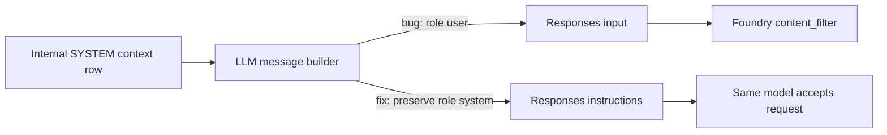

## Problem

Read-only explore children `/root/rose_deployment_context` and
`/root/grep_failure_evidence` retrieved records but failed before returning
summaries. Their final requests were `bb2bb084` and `9f3d4fd5`; a subsequent
`/root/grep_error_evidence_retry` failed as `98267376`. Each group made three
failed calls on `gpt-6-luna-foundry`, with refusal text followed by the typed
`RoseRefusalError`. The separate backend grep repair remains separately owned.

Archive searches: `Responses stream incomplete content_filter`,
`explore LLM call failed 3 consecutive times`,
`SYSTEM user message content filter jailbreak winddown`, and
`explore winddown final turn`; literal `content_filter` initially had no case
hit. This is novel at the authority-projection boundary. The October 25
browser partial-refusal recovery case is a relative: it warns against
accepting partial output, but adding its recovery policy would leave this
earlier corrupt projection intact. The October 18 Responses system-boundary
case supplies the relevant lesson to assert actual provider instructions,
preserve non-system data and distinguish cache reconstruction from causality.

Before editing, the coordinator read 45 active project thread previews,
including active Bug Report runs, and inspected provider-related threads and
open PRs. PR2404's owner confirmed its selected-field/provider-schema work has
no overlapping Python client or role-mapping repair. The Polar judge owner
confirmed its context-length/HTTP400 error-capture investigation is distinct.
Their evidence and scope were exchanged through managed agent messages.

## Diagnosis

What: valid explore work dies at its final synthesis turn. Where:
`_render_llm_messages` demotes `SYSTEM` to `user`. Why: the internal
wind-down notice originates as SYSTEM in `loop/run_agent.py`, but its
projection makes it look like a user claiming system authority. The Responses
serializer correctly routes the resulting user message into `input`, not
`instructions`. The provider then rejects it and the agent retries the same
malformed authority three times. The parser correctly surfaces the refusal.
Problem: loss of declared instruction authority during context projection.

Proof: archived call spans `5df5fd89d224`, `e1565a0f15d8`, and `9f994ad2a05b`
contain the exact user-role final notice and their refusal outputs. Exact
same-client replays of all three original conversations and nine tool schemas
fail on Foundry West US, GPT6 Luna. Live SSE reports a prompt jailbreak
classification; other safety categories are safe. Original historical SSE
was not archived, so its detailed classification is inferred from the
reproducing requests rather than claimed as historical wire evidence.

Changing only the final message role, keeping every text byte including its
timestamp and `[SYSTEM]:` prefix, succeeds 3/3 on the same model and region.
The initial corrected builder produces those exact texts and avoids refusal
in all three complete-conversation live replays, requests `71fcf59d1a59`,
`fdaf3ac748df`, and `1307ac466583`. Two returned synthesis completion; the
third requested more grep calls. These prove provider acceptance, not complete
end-to-end child recovery. Model, tool schemas, task, provider filters,
budgets and generation settings are unchanged. A healthy greeting on the same
route succeeds, and removing tools from the original request still refuses.

The serving machine's pre-incident image metadata names build `457cc757d706`;
its relevant Python files match the local `562cc8c490` baseline. Production
logs identify Foundry/model; region is established by the local wire capture.

The why ladder stops at role projection, not provider policy or model choice.
The existing alternate `convert_context_to_messages` preserves SYSTEM
authority, but this is not sufficient provenance for every historical SYSTEM
row: an unreachable blueprint-injection path wraps user/model/tool reference
material in SYSTEM. External ingress permits SYSTEM only for internal callers;
ordinary callers become USER. The final repair narrows authority to explicitly
identified loop-control instructions and leaves generic historical/reference
SYSTEM material at its existing projection. No role is inferred from text.
The more general proposal to promote any text labeled `[SYSTEM]` is incoherent
and unsafe: arbitrary user/tool content can contain that label. Preserve the
declared role instead. No prompt edit is needed.

## Solution

The message builder preserves system authority only for typed internal
loop-control instructions, retaining every content byte. Generic historical
SYSTEM rows, blueprint/reference material, user and tool text retain their
existing authority, including literal `[SYSTEM]` strings. The loop identifies
its existing wind-down, repetition and no-tool notices explicitly; no text
matching or instruction-specific keyword rule is used. No fallback, prompt rewrite, model switch,
budget change, synthetic trajectory message or keyword classifier is added.

The registered `llm` blackbox regression exercises the real message builder,
Rose client, Foundry body builder and Responses parser. A captured-shape
provider fixture returns the observed content-filter terminal event for the
bad projection. It asserts one request on the intended original model, exact
instructions, untrusted user/tool negative controls, reference identity,
unchanged main prompt/cache marker, original context order and no mutation.
The role correction moves the control into provider instructions before
conversation history. Where the base system prompt has a dynamic boundary,
its cache prefix is unchanged; the actual incident prompts lacked that
boundary, so the newly authoritative notice also changes `prompt_cache_key`.
That known cache consequence is not claimed invariant. Message-level role-only
controls are not single-field-only wire mutations: `input`, `instructions`
and cache identity all change. No unique stochastic-model cause is claimed.
The identical focused command `source agents/venv/bin/activate && python
/tmp/047fff-run-role-regression.py` exited 1 before the fix with the observed
content-filter cause, then exited 0 five consecutive times with five focused
assertion cases. The initial broad-projection regression was registered in `run_all_tests`;
`select_affected_tests.py --lanes-for agents/tests/blackbox/llm.blackbox.py`
resolves to `agents-blackbox llm`. Before the provenance refinement, the full Rose suite passed 314 cases, Rose browser-use passed 131 and LLM
passed 278 (28.9 seconds combined). The supported stability runner passed
all three changed cases five consecutive times under eight occupied load
slots (7 seconds). Independent review identified broader trust, cache and evidence-claim gaps.
A narrower typed-control revision and its validation are in progress;
deployment remains pending.

Private evidence retains exact requests, SSE, commands, provider/model
observations and the discarded downstream recovery experiment. A flag-only
recovery control returned a final answer contaminated with refusal text,
which is additional evidence against that proposed repair. It is not shipped.
The set-plan serializer treats old SYSTEM rows as historical user reference
data; this repair intentionally preserves that behavior and does not change
its prompt assembly. The original production viewer has no benchmark run UUID,
so the canonical publisher refuses it. An equivalent read-only complete API,
HTTP viewer and shared browser-recording validator audit passed; this means
verified reachable, not rendered or a fabricated benchmark share.

At 10,000 agents the change replaces one scalar role value in an existing
linear projection. It adds no I/O, shared state, locks, requests or retries.

## Human feedback

The user required reading other active bug threads and reconciling actual
ownership before editing, and completing deployment after RCA. No additional
incident-specific correction was recorded.

## Reusable lesson

When a provider flags an internal notice as prompt injection, compare its
declared source role with the actual provider-body role before adding retries
or rewriting the notice.

## Provenance refinement after independent review

The first independent reviewer confirmed the first bad boundary, then rejected
the broad role correction. Its blanket trust rule also promoted untagged
reference material, overstated three successful summaries, and omitted actual
cache consequences. The final implementation adds optional boolean
`metadata.internal_instruction` only at the three existing fixed loop-control
producers and requires `role == SYSTEM` plus literal `True` in the renderer.
Unknown/imported SYSTEM rows, blueprint/reference and attachment data retain
the old user projection. USER/TOOL rows cannot gain authority by spoofing the
flag, and string `true` is not accepted. No instruction text, insertion timing,
agent limit or tool/model selection changes. Existing historical untagged
controls are not inferred or migrated.

The unchanged seven-case `/tmp/047fff-typed-regression.py` fails on the broad
first candidate because untagged blueprint material enters instructions, and
passes on the narrowed candidate five consecutive times. Current permanent
transport assertions also fail against original `562cc8c490` loaded read-only
in a separate process: the tagged instruction is absent from instructions.
This is direct projection evidence; the original full-request replay supplies
the independently observed content-filter reproduction. No source checkout or
canonical context is mutated for the baseline control.

The narrowed full suites pass Rose314, browser-use131, LLM278, run-agent104
in46.4s. The supported stability runner passes five changed cases across both
owning domains five consecutive times under eight occupied CPU slots in7s.
The live typed-builder replays avoid content_filter3/3: two provide usable
completion summaries; third request `395f949a7edb` reaches its original8192
output limit with invalid tool arguments. This is not a complete-child outcome
pass, and no budget or parser assertion was changed to hide it.

Reference review must distinguish base-policy authority from reminders: Claude
critical reminders and Hermes final-turn reminders use user messages; Codex
typed rollout-budget controls use developer authority. Rose follows the latter
provenance pattern for fixed internal controls because the existing SYSTEM
label in user input reproduces the Foundry rejection, while reference/history
data remain untrusted. The source retains the original three notices rather
than adding new runtime nudges.
