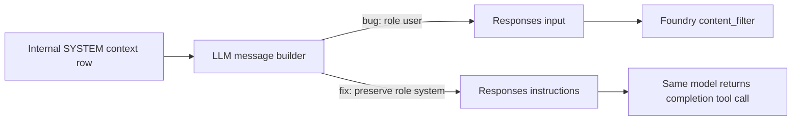

## Problem

Read-only explore children `/root/rose_deployment_context` and
`/root/grep_failure_evidence` retrieved records but failed before returning
summaries. Their final requests were `bb2bb084` and `9f3d4fd5`; a subsequent
`/root/grep_error_evidence_retry` failed as `98267376`. Each group made three
failed calls on `gpt-6-luna-foundry`, with refusal text followed by the typed
`RoseRefusalError`. The separate backend grep repair remains separately owned.

Archive searches: `Responses stream incomplete content_filter`,
`explore LLM call failed 3 consecutive times`,
`SYSTEM user message content filter jailbreak winddown`, and
`explore winddown final turn`; literal `content_filter` initially had no case
hit. This is novel at the authority-projection boundary. The October 25
browser partial-refusal recovery case is a relative: it warns against
accepting partial output, but adding its recovery policy would leave this
earlier corrupt projection intact. The October 18 Responses system-boundary
case supplies the relevant lesson to assert actual provider instructions,
preserve non-system data and distinguish cache reconstruction from causality.

Before editing, the coordinator read 45 active project thread previews,
including active Bug Report runs, and inspected provider-related threads and
open PRs. PR2404's owner confirmed its selected-field/provider-schema work has
no overlapping Python client or role-mapping repair. The Polar judge owner
confirmed its context-length/HTTP400 error-capture investigation is distinct.
Their evidence and scope were exchanged through managed agent messages.

## Diagnosis

What: valid explore work dies at its final synthesis turn. Where:
`_render_llm_messages` demotes `SYSTEM` to `user`. Why: the internal
wind-down notice originates as SYSTEM in `loop/run_agent.py`, but its
projection makes it look like a user claiming system authority. The Responses
serializer correctly routes the resulting user message into `input`, not
`instructions`. The provider then rejects it and the agent retries the same
malformed authority three times. The parser correctly surfaces the refusal.
Problem: loss of declared instruction authority during context projection.

Proof: archived call spans `5df5fd89d224`, `e1565a0f15d8`, and `9f994ad2a05b`
contain the exact user-role final notice and their refusal outputs. Exact
same-client replays of all three original conversations and nine tool schemas
fail on Foundry West US, GPT6 Luna. Live SSE reports a prompt jailbreak
classification; other safety categories are safe. Original historical SSE
was not archived, so its detailed classification is inferred from the
reproducing requests rather than claimed as historical wire evidence.

Changing only the final message role, keeping every text byte including its
timestamp and `[SYSTEM]:` prefix, succeeds 3/3 on the same model and region.
The corrected source builder also produces those exact texts and passes all
three complete-conversation live replays, requests `71fcf59d1a59`,
`fdaf3ac748df`, and `1307ac466583`. Model, tool schemas, task, provider filters,
budgets and generation settings are unchanged. A healthy greeting on the same
route succeeds, and removing tools from the original request still refuses.

The serving machine's pre-incident image metadata names build `457cc757d706`;
its relevant Python files match the local `562cc8c490` baseline. Production
logs identify Foundry/model; region is established by the local wire capture.

The why ladder stops at role projection, not provider policy or model choice.
The existing alternate `convert_context_to_messages` already preserves SYSTEM
authority. Internal message ingress permits SYSTEM only for internal callers;
external callers become USER. Known SYSTEM producers are internal control
notices and reference-blueprint wrappers. No role is inferred from text.
The more general proposal to promote any text labeled `[SYSTEM]` is incoherent
and unsafe: arbitrary user/tool content can contain that label. Preserve the
declared role instead. No prompt edit is needed.

## Solution

The message builder retains the declared SYSTEM role and every existing
content byte. User and tool text remain at their original authority, including
literal `[SYSTEM]` strings. This corrects all same-class SYSTEM projections,
including internal wind-down, repetition and no-tool notices, rather than
special-casing one final-turn string. No fallback, prompt rewrite, model switch,
budget change, synthetic trajectory message or keyword classifier is added.

The registered `llm` blackbox regression exercises the real message builder,
Rose client, Foundry body builder and Responses parser. A captured-shape
provider fixture returns the observed content-filter terminal event for the
bad projection. It asserts one request on the intended original model, exact
instructions, untrusted user/tool negative controls, reference identity,
unchanged main prompt/cache marker, original context order and no mutation.
The identical focused command `source agents/venv/bin/activate && python
/tmp/047fff-run-role-regression.py` exited 1 before the fix with the observed
content-filter cause, then exited 0 five consecutive times with five focused
assertion cases. The permanent regression is registered in `run_all_tests`;
`select_affected_tests.py --lanes-for agents/tests/blackbox/llm.blackbox.py`
resolves to `agents-blackbox llm`. The full Rose suite passed 314 cases, Rose browser-use passed 131 and LLM
passed 278 (28.9 seconds combined). The supported stability runner passed
all three changed cases five consecutive times under eight occupied load
slots (7 seconds). Independent review and deployment remain pending.

Private evidence retains exact requests, SSE, commands, provider/model
observations and the discarded downstream recovery experiment. A flag-only
recovery control returned a final answer contaminated with refusal text,
which is additional evidence against that proposed repair. It is not shipped.

At 10,000 agents the change replaces one scalar role value in an existing
linear projection. It adds no I/O, shared state, locks, requests or retries.

## Human feedback

The user required reading other active bug threads and reconciling actual
ownership before editing, and completing deployment after RCA. No additional
incident-specific correction was recorded.

## Reusable lesson

When a provider flags an internal notice as prompt injection, compare its
declared source role with the actual provider-body role before adding retries
or rewriting the notice.
